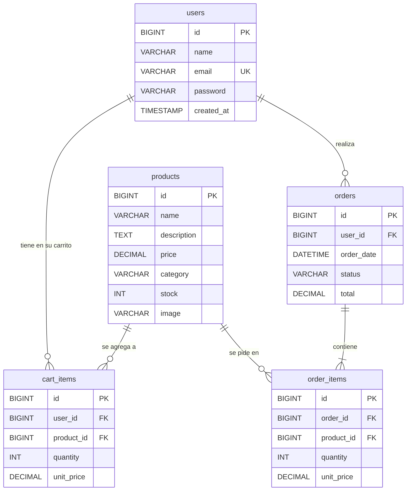

# Configuración de servidores y base de datos

> Ver también: [AMBIENTES.md](AMBIENTES.md) · [DESPLIEGUE.md](DESPLIEGUE.md) · [MANUAL_TECNICO.md](MANUAL_TECNICO.md)

## 1. Servidores y puertos

| Servidor / módulo | Tecnología | Puerto | Dónde se configura |
|-------------------|-----------|--------|--------------------|
| Backend principal | Spring Boot 3.2.5 (Tomcat 10.1.20 embebido) | **8090** | `src/main/resources/application.properties` → `server.port` |
| Frontend (desarrollo) | Vite 5 | **4300** (`strictPort`) | `frontend/vite.config.js` → `server.port` |
| Frontend (vista previa del build) | `vite preview` | 4173 (por defecto de Vite) | comando `npm run preview` |
| auth-service | Spring Boot 3.2.5 | **8080** (por defecto, sin configurar) | `auth-service/` (no tiene `application.properties`) |
| Módulo Servlets/JSP | Apache Tomcat 10.1+ | **8080** (por defecto de Tomcat), contexto `/beautyshop-web` | nombre del WAR |
| Base de datos | MySQL | **3306** | `spring.datasource.url` |

> `auth-service` y Tomcat usan el mismo puerto 8080: **no se pueden ejecutar a la vez** sin cambiar uno de los dos (por ejemplo `java -jar auth-service.jar --server.port=8081`).

### 1.1 Claves de `application.properties` (backend principal)

| Clave | Valor en el proyecto | Para qué sirve |
|-------|---------------------|----------------|
| `spring.application.name` | `beautyshop-backend` | Nombre de la aplicación |
| `server.port` | `8090` | Puerto HTTP de la API |
| `spring.datasource.url` | `jdbc:mysql://localhost:3306/beautyshop?useSSL=false&serverTimezone=UTC&allowPublicKeyRetrieval=true` | Conexión JDBC |
| `spring.datasource.username` | `root` | Usuario de MySQL |
| `spring.datasource.password` | *(vacío en el entorno local; coloca aquí tu contraseña)* | Contraseña de MySQL |
| `spring.datasource.driver-class-name` | `com.mysql.cj.jdbc.Driver` | Driver JDBC |
| `springdoc.swagger-ui.path` | `/swagger-ui.html` | Ruta de Swagger UI |
| `springdoc.api-docs.path` | `/v3/api-docs` | Ruta de la especificación OpenAPI |
| `springdoc.swagger-ui.tags-sorter` | `alpha` | Orden alfabético de grupos |
| `springdoc.swagger-ui.operations-sorter` | `method` | Orden de operaciones por método HTTP |

Las propiedades `spring.datasource.*` las lee `config/DatabaseConfig`, que crea el `DataSource`. Cualquier clave puede sobrescribirse sin editar el archivo:

```bash
java -jar ejecutables/beautyshop-backend.jar \
  --spring.datasource.username=mi_usuario \
  --spring.datasource.password=mi_clave \
  --server.port=8090
```

### 1.2 Proxy de Vite (frontend → backend)

En `frontend/vite.config.js`:

```js
server: {
  host: '127.0.0.1',
  port: 4300,
  strictPort: true,
  proxy: { '/api': { target: 'http://127.0.0.1:8090', changeOrigin: true } }
}
```

El frontend llama siempre a rutas relativas (`/api/...`, definido en `src/services/api.js`); Vite las reenvía al backend. Por eso en desarrollo no hay problemas de CORS. `vite preview` reutiliza este mismo proxy (comprobado: `http://127.0.0.1:4173/api/products/1` responde `200`).

### 1.3 Tomcat (módulo Servlets/JSP)

1. Requiere **Tomcat 10.1 o superior** (namespace `jakarta.*`). Con Tomcat 9 o anterior no funciona sin cambiar los imports a `javax.*`.
2. Copiar `ejecutables/beautyshop-web.war` a `webapps/` de Tomcat y arrancar. El contexto es el nombre del WAR: `http://localhost:8080/beautyshop-web/`.
3. La conexión a MySQL se define en `DatabaseConnection`: URL `jdbc:mysql://localhost:3306/beautyshop?...`, usuario y contraseña por defecto `root` / `root`. Se pueden sobrescribir con las variables de entorno **`BEAUTYSHOP_DB_USER`** y **`BEAUTYSHOP_DB_PASSWORD`** antes de arrancar Tomcat:

```bash
export BEAUTYSHOP_DB_USER=root
export BEAUTYSHOP_DB_PASSWORD=''      # la contraseña de tu MySQL (aquí, vacía)
$CATALINA_HOME/bin/catalina.sh run
```

El driver `mysql-connector-j 8.3.0` viene empaquetado dentro del WAR.

## 2. Base de datos

- **Motor:** MySQL (probado con MySQL Server 9.5.0). **Base de datos:** `beautyshop` (`utf8mb4`, `utf8mb4_unicode_ci`).
- **Usuario de conexión:** `root` en el entorno local de desarrollo. Para un entorno compartido crea un usuario propio:

```sql
CREATE USER 'beautyshop_app'@'localhost' IDENTIFIED BY '<TU_CONTRASENA>';
GRANT ALL PRIVILEGES ON beautyshop.* TO 'beautyshop_app'@'localhost';
```

  y colócalo en `spring.datasource.username` / `spring.datasource.password` (o por línea de comandos). **No guardes contraseñas reales en el repositorio.**

### 2.1 Scripts (`database/`)

Se ejecutan en este orden y **son idempotentes** (se pueden correr varias veces sin duplicar datos):

| Orden | Script | Qué crea |
|-------|--------|----------|
| 1 | `database/products.sql` | Base `beautyshop`, tabla `products` y 5 productos de ejemplo (solo si la tabla está vacía) |
| 2 | `database/users.sql` | Tabla `users` y el usuario demo `demo@beautyshop.com` (contraseña `demo1234`, solo para pruebas e2e) |
| 3 | `database/cart_orders.sql` | Tablas `cart_items`, `orders`, `order_items` (requieren `users` y `products`) |

```bash
mysql -u root -p < database/products.sql
mysql -u root -p < database/users.sql
mysql -u root -p < database/cart_orders.sql
```

(Con contraseña vacía basta `mysql -u root < ...`.) `web-servlets-module/database/users.sql` y `jdbc-demo/database/products.sql` son los scripts propios de esos dos módulos (crean las mismas tablas `users` y `products`).

### 2.2 Tablas

| Tabla | Columnas principales | Claves |
|-------|---------------------|--------|
| `products` | `id`, `name`, `description`, `price DECIMAL(10,2)`, `category`, `stock`, `image` | PK `id` |
| `users` | `id`, `name`, `email`, `password` (hash SHA-256), `created_at` | PK `id`; único `uk_users_email` |
| `cart_items` | `id`, `user_id`, `product_id`, `quantity`, `unit_price DECIMAL(10,2)` | PK `id`; único `(user_id, product_id)`; FK a `users` y `products` (`ON DELETE CASCADE`) |
| `orders` | `id`, `user_id`, `order_date`, `status` (por defecto `pendiente`), `total DECIMAL(12,2)` | PK `id`; FK a `users` (`ON DELETE CASCADE`) |
| `order_items` | `id`, `order_id`, `product_id`, `quantity`, `unit_price DECIMAL(10,2)` | PK `id`; FK a `orders` y `products` (`ON DELETE CASCADE`) |

### 2.3 Diagrama entidad–relación



Nota de modelo: el backend usa nombres en español en el JSON (`idUsuario`, `cantidad`, `precioUnitario`, `estado`) y los mapea a las columnas en inglés (`user_id`, `quantity`, `unit_price`, `status`) dentro de los repositorios.

## 3. Cómo ejecutar cada módulo

Requisitos previos: MySQL en marcha y scripts cargados (§2.1); `JAVA_HOME` apuntando a un JDK 17 (en macOS con Homebrew: `export JAVA_HOME=/opt/homebrew/opt/openjdk@17`).

| Módulo | Desde el código fuente | Desde los ejecutables (`ejecutables/`) |
|--------|-----------------------|----------------------------------------|
| Backend (8090) | `./mvnw spring-boot:run` (raíz) | `java -jar ejecutables/beautyshop-backend.jar` |
| Frontend (4300) | `cd frontend && npm ci && npm run dev` | `cd frontend && npm run preview` (sirve `dist/` en 4173 con el mismo proxy); `ejecutables/frontend-dist/` es el build estático para cualquier servidor web que reenvíe `/api` al backend |
| auth-service (8080) | `cd auth-service && ./mvnw spring-boot:run` | `java -jar ejecutables/auth-service.jar` |
| Servlets/JSP (8080) | `./mvnw -f web-servlets-module/pom.xml clean package` | copiar `ejecutables/beautyshop-web.war` a `webapps/` de Tomcat 10.1 |
| JDBC demo | `cd jdbc-demo && ./mvnw -q compile exec:java` | — |
| Pruebas unitarias (raíz) | `./mvnw test` | — |
| Pruebas unitarias (auth-service) | `cd auth-service && ./mvnw test` | — |
| Pruebas e2e | `cd frontend && npx playwright install chromium && npx playwright test` (con backend y MySQL activos) | — |

Para regenerar los ejecutables:

```bash
./mvnw clean package                                   # target/beautyshop-backend-1.0.0.jar
(cd auth-service && ./mvnw clean package)              # target/auth-service-1.0.0.jar
./mvnw -f web-servlets-module/pom.xml clean package    # web-servlets-module/target/beautyshop-web.war
(cd frontend && npm ci && npm run build)               # frontend/dist/
```

y copiarlos a `ejecutables/` con los nombres `beautyshop-backend.jar`, `auth-service.jar`, `beautyshop-web.war` y `frontend-dist/`.
