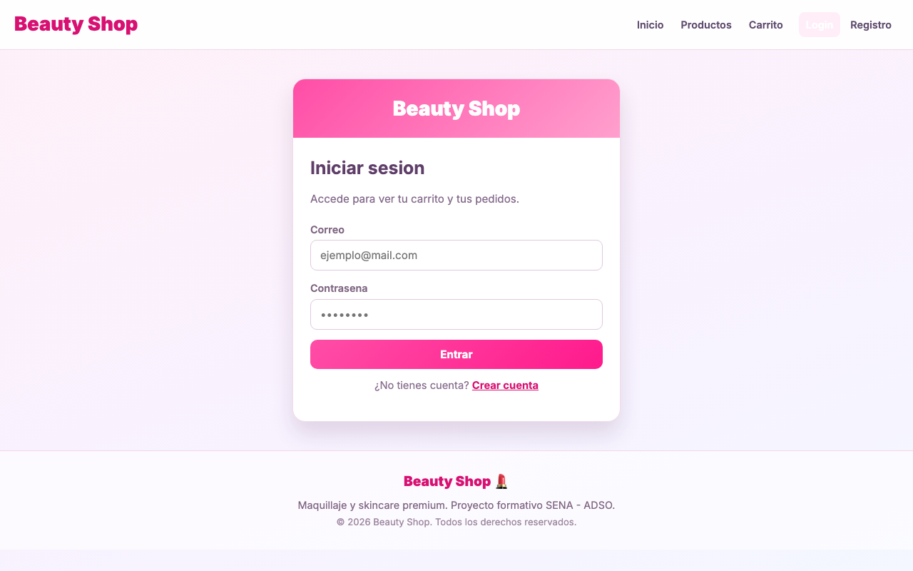
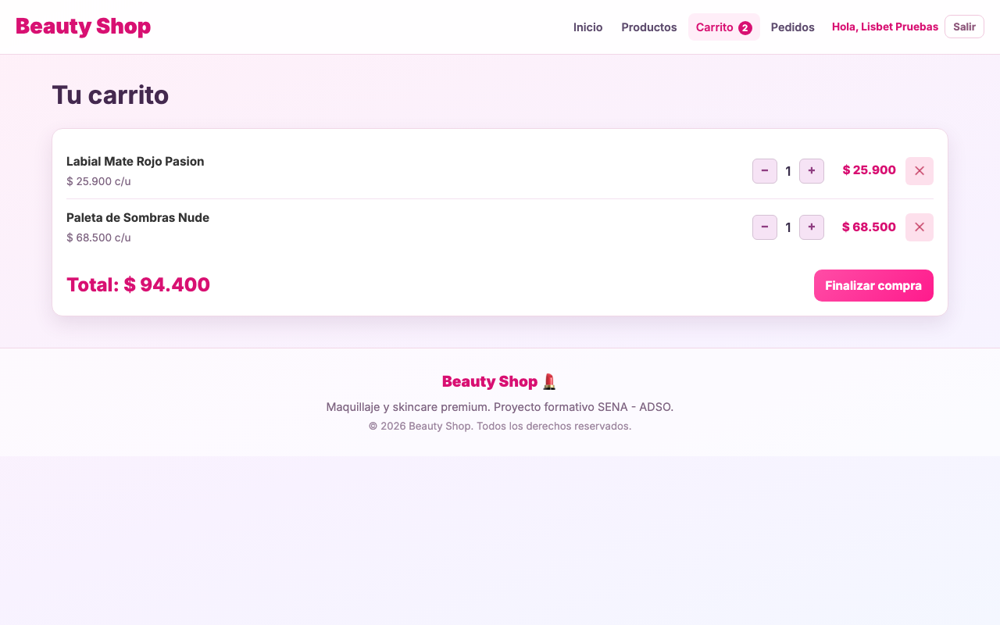
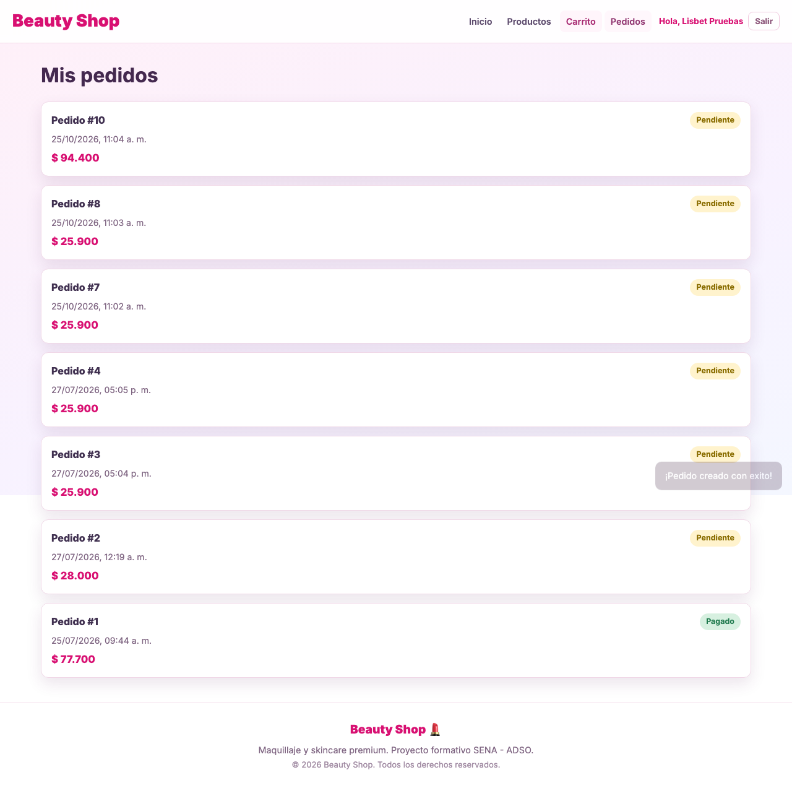
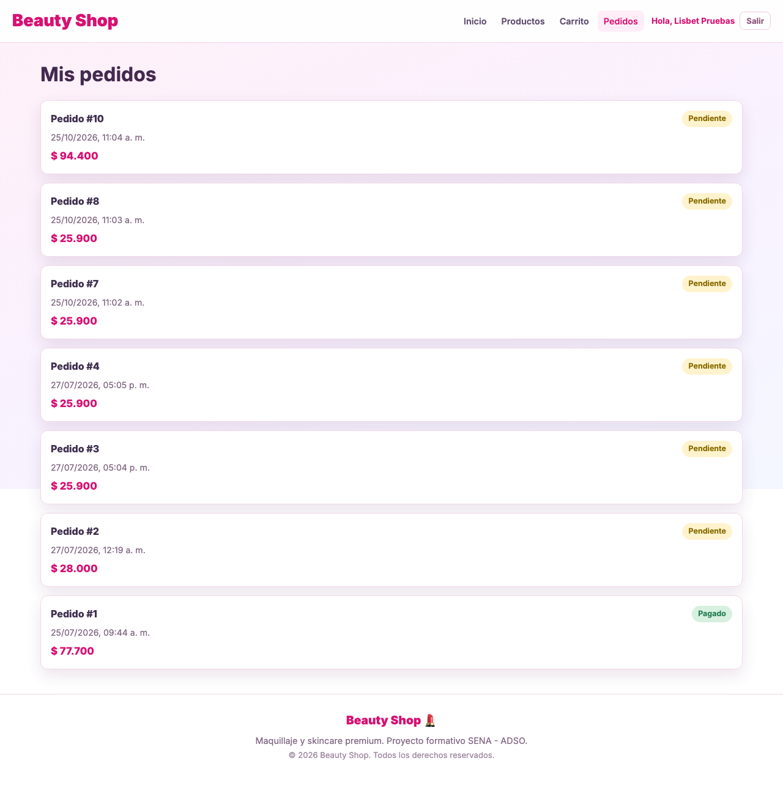
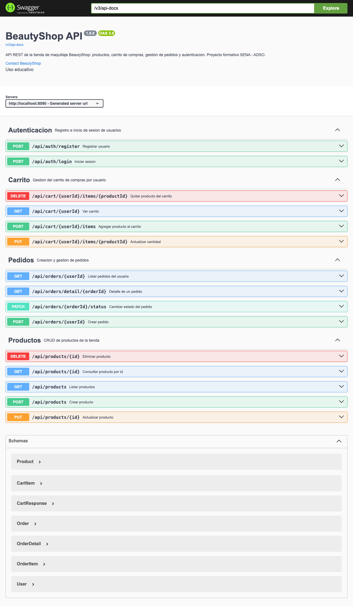
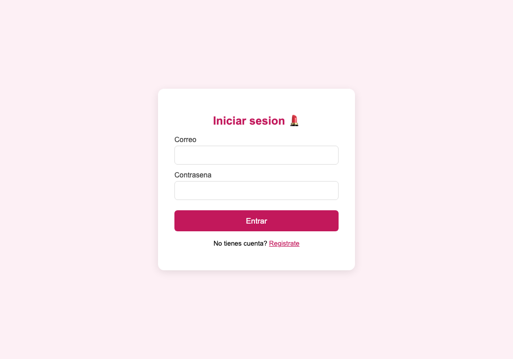
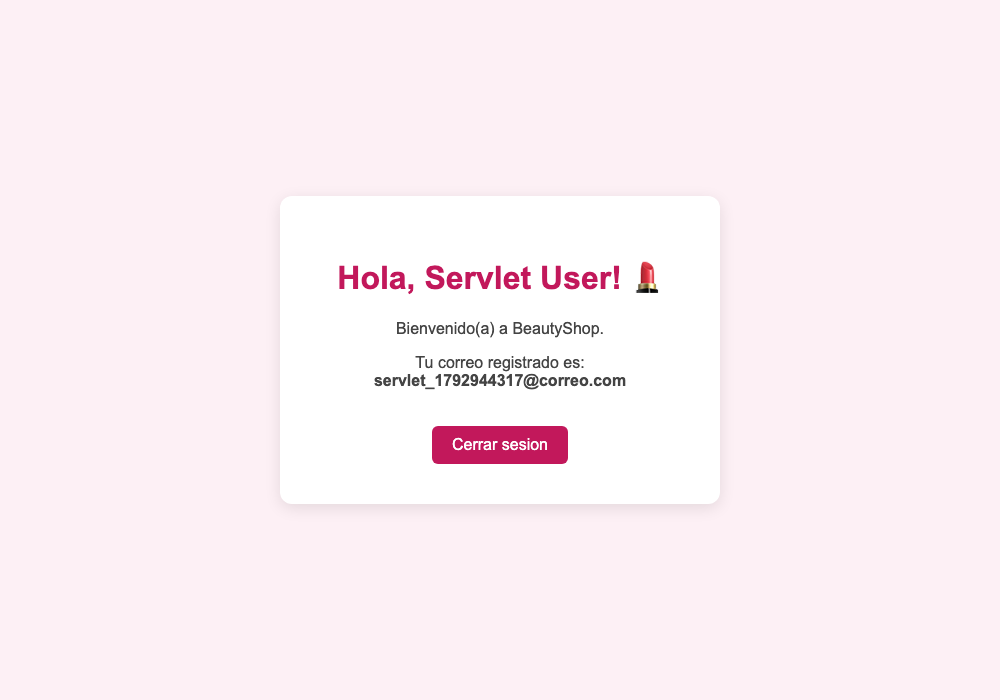

# Despliegue de BeautyShop

**Tipo de despliegue: local.** Todos los módulos se ejecutaron en el equipo de desarrollo (macOS, JDK 17, MySQL 9.5.0, Tomcat 10.1.61). **No se desplegó en la nube** ni en un servidor público; por eso las URLs de esta guía son `localhost`.

> Ver también: [CONFIGURACION.md](CONFIGURACION.md) · [AMBIENTES.md](AMBIENTES.md) · [INFORME_PRUEBAS.md](INFORME_PRUEBAS.md)

## 1. Ejecutables entregados (`ejecutables/`)

| Archivo | Módulo | Se genera con | Cómo se ejecuta |
|---------|--------|---------------|-----------------|
| `beautyshop-backend.jar` | Backend Spring Boot (API REST) | `./mvnw clean package` | `java -jar ejecutables/beautyshop-backend.jar` |
| `auth-service.jar` | Microservicio de autenticación en memoria | `cd auth-service && ./mvnw clean package` | `java -jar ejecutables/auth-service.jar` |
| `beautyshop-web.war` | Módulo Servlets + JSP | `./mvnw -f web-servlets-module/pom.xml clean package` | Copiar a `webapps/` de Tomcat 10.1 |
| `frontend-dist/` | Frontend React (build de producción) | `cd frontend && npm ci && npm run build` | `cd frontend && npm run preview`, o servir la carpeta con cualquier servidor web que reenvíe `/api` al backend |

## 2. URLs locales de cada módulo

| Módulo | URL | Cómo verificar |
|--------|-----|----------------|
| Backend — productos | `http://localhost:8090/api/products` | Devuelve la lista JSON |
| Backend — autenticación | `http://localhost:8090/api/auth/register`, `/login` | `POST` con JSON |
| Backend — carrito | `http://localhost:8090/api/cart/{userId}` | |
| Backend — pedidos | `http://localhost:8090/api/orders/{userId}` | |
| **Swagger UI** | `http://localhost:8090/swagger-ui.html` | Ver [captura](capturas/07_swagger_ui.png) |
| Especificación OpenAPI | `http://localhost:8090/v3/api-docs` | JSON |
| Frontend (desarrollo) | `http://localhost:4300` | Tienda completa |
| Frontend (build de producción) | `http://127.0.0.1:4173` | `npm run preview`; comprobado: `/` → 200, `/carrito` → 200 y `/api/products/1` → 200 por el proxy |
| auth-service | `http://localhost:8080/api/auth/register`, `/login` | Colección Postman |
| Servlets/JSP | `http://localhost:8080/beautyshop-web/` | Abre `login.html` |
| JDBC demo | (consola) | `cd jdbc-demo && ./mvnw -q compile exec:java` |

Recuerda que `auth-service` y Tomcat comparten el puerto 8080: ejecuta uno a la vez.

## 3. Pasos del despliegue local

```bash
export JAVA_HOME=/opt/homebrew/opt/openjdk@17

# 1. Base de datos (idempotente)
mysql -u root < database/products.sql
mysql -u root < database/users.sql
mysql -u root < database/cart_orders.sql

# 2. Backend en 8090 (ajusta usuario/contraseña si tu MySQL los tiene)
java -jar ejecutables/beautyshop-backend.jar \
  --spring.datasource.username=root --spring.datasource.password=

# 3. Frontend en 4300 (desarrollo) o 4173 (build)
cd frontend && npm ci && npm run dev       # o: npm run build && npm run preview

# 4. (Opcional) Servlets/JSP en Tomcat 10.1
export BEAUTYSHOP_DB_USER=root BEAUTYSHOP_DB_PASSWORD=''
cp ejecutables/beautyshop-web.war $CATALINA_HOME/webapps/ && $CATALINA_HOME/bin/catalina.sh run
```

Qué se desplegó realmente en la verificación del 25/10/2026:

| Módulo | Desplegado | Cómo |
|--------|-----------|------|
| Backend (8090) | ✅ | Pruebas de API, e2e y capturas contra el backend en el puerto 8090 (arrancado con `./mvnw spring-boot:run`). El JAR de `ejecutables/` se verificó aparte con `java -jar ... --server.port=8091` (`/api/products`, `/v3/api-docs` y `/api/cart/1` respondieron `200`) |
| Frontend (4300 y 4173) | ✅ | `npm run dev` y `npm run preview` |
| auth-service (8080) | ✅ | `java -jar ejecutables/auth-service.jar` |
| Servlets/JSP en Tomcat 10.1.61 | ✅ | WAR copiado a un `CATALINA_BASE` temporal, puerto 8080 |
| JDBC demo | ✅ | `./mvnw -q compile exec:java` |
| Nube / servidor público | ❌ No realizado | La decisión del proyecto fue despliegue local documentado |

Al terminar la verificación se detuvieron los servidores de frontend, auth-service y Tomcat.

## 4. Capturas del sistema en ejecución

Tomadas con Playwright (Chromium) sobre el despliegue local.

### Catálogo — `http://localhost:4300/catalogo`


### Inicio de sesión — `http://localhost:4300/login`



### Carrito con productos — `http://localhost:4300/carrito`


### Pedido creado (aviso «¡Pedido creado con exito!»)


### Historial de pedidos — `http://localhost:4300/pedidos`


### Swagger UI — `http://localhost:8090/swagger-ui.html`


### Módulo Servlets/JSP — `http://localhost:8080/beautyshop-web/`




## 5. Detener los servicios

- Backend / auth-service / frontend: `Ctrl + C` en la terminal donde corren.
- Tomcat: `$CATALINA_HOME/bin/catalina.sh stop` (o `Ctrl + C` si se inició con `run`).
- MySQL (Homebrew): `brew services stop mysql`.
