# Manual técnico — BeautyShop

Evidencias **GA8-220501096-AA1-EV01** y **AA1-EV02**. Tienda en línea de maquillaje (proyecto formativo SENA — ADSO).
Este manual describe cómo está construido el sistema, con datos tomados del código y de las ejecuciones reales del proyecto.

> Documentos relacionados: [REQUISITOS.md](REQUISITOS.md) · [ACTA_APROBACION_REQUISITOS.md](ACTA_APROBACION_REQUISITOS.md) · [MODULOS.md](MODULOS.md) · [CONFIGURACION.md](CONFIGURACION.md) · [AMBIENTES.md](AMBIENTES.md) · [INFORME_PRUEBAS.md](INFORME_PRUEBAS.md) · [DESPLIEGUE.md](DESPLIEGUE.md)

## 1. Arquitectura por capas

El sistema sigue una arquitectura cliente–servidor en capas. Cada capa solo habla con la capa inmediatamente inferior.

| Capa | Tecnología | Ubicación | Responsabilidad |
|------|-----------|-----------|-----------------|
| Presentación | React 18 + Vite (SPA) | `frontend/src` | Pantallas, formularios, estado de sesión y carrito |
| Controladores REST | Spring MVC (`@RestController`) | `com.beautyshop.controller`, `.auth`, `.cart`, `.order` | Reciben HTTP, convierten JSON ⇄ objetos, devuelven códigos de estado |
| Servicios | Spring (`@Service`) | `com.beautyshop.service`, `.auth`, `.cart`, `.order` | Reglas de negocio y validaciones |
| Repositorios | JDBC puro (`PreparedStatement`) | `com.beautyshop.repository`, `.cart`, `.order` | Consultas SQL; sin ORM |
| Base de datos | MySQL, base `beautyshop` | `database/*.sql` | Persistencia (5 tablas) |

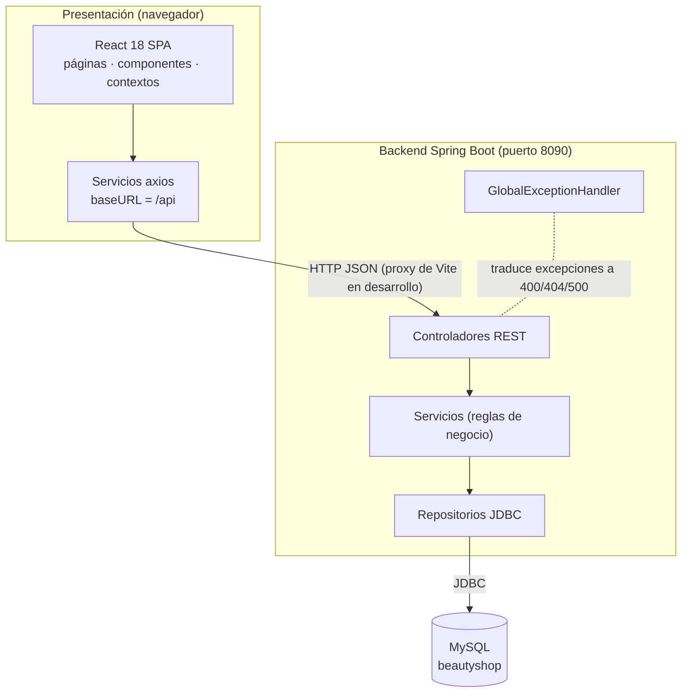

## 2. Diagrama de componentes

Incluye todos los módulos del repositorio. Los módulos `auth-service`, `web-servlets-module` y `jdbc-demo` son independientes del backend principal (los dos últimos usan la misma base de datos `beautyshop`).

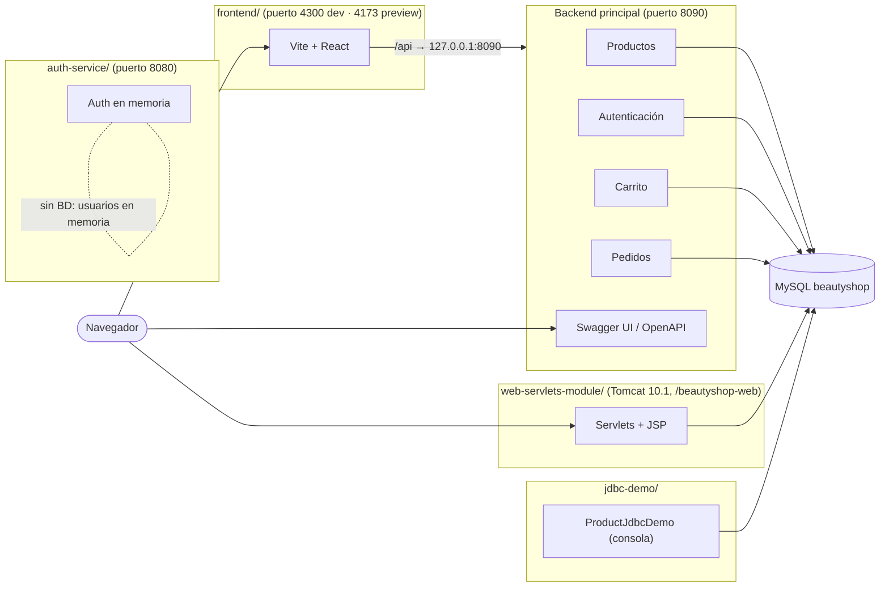

## 3. Diagrama de paquetes (backend principal)

Paquete raíz `com.beautyshop`. Las flechas indican "depende de".

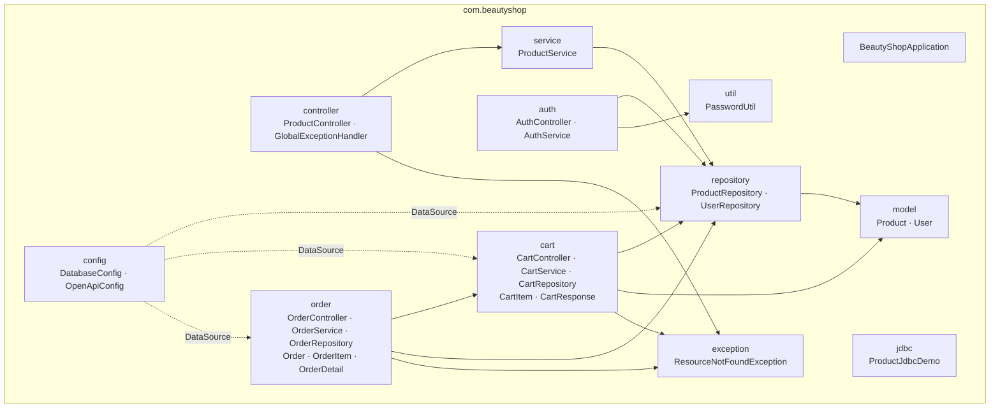

Nota: los módulos de carrito y pedidos se organizaron en paquetes propios (`cart`, `order`) que agrupan controlador, servicio, repositorio y modelos de cada módulo; productos y autenticación usan los paquetes por capa.

## 4. Diagramas de clases por módulo

Se construyeron a partir del código real (campos y métodos públicos principales).

### 4.1 Productos

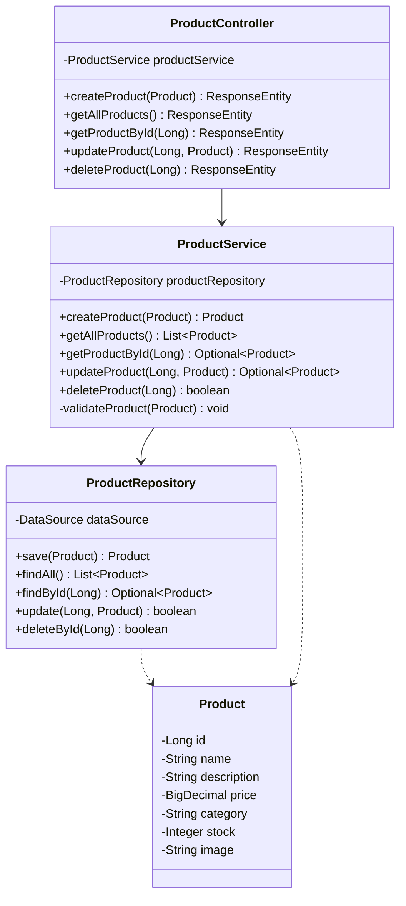

### 4.2 Autenticación

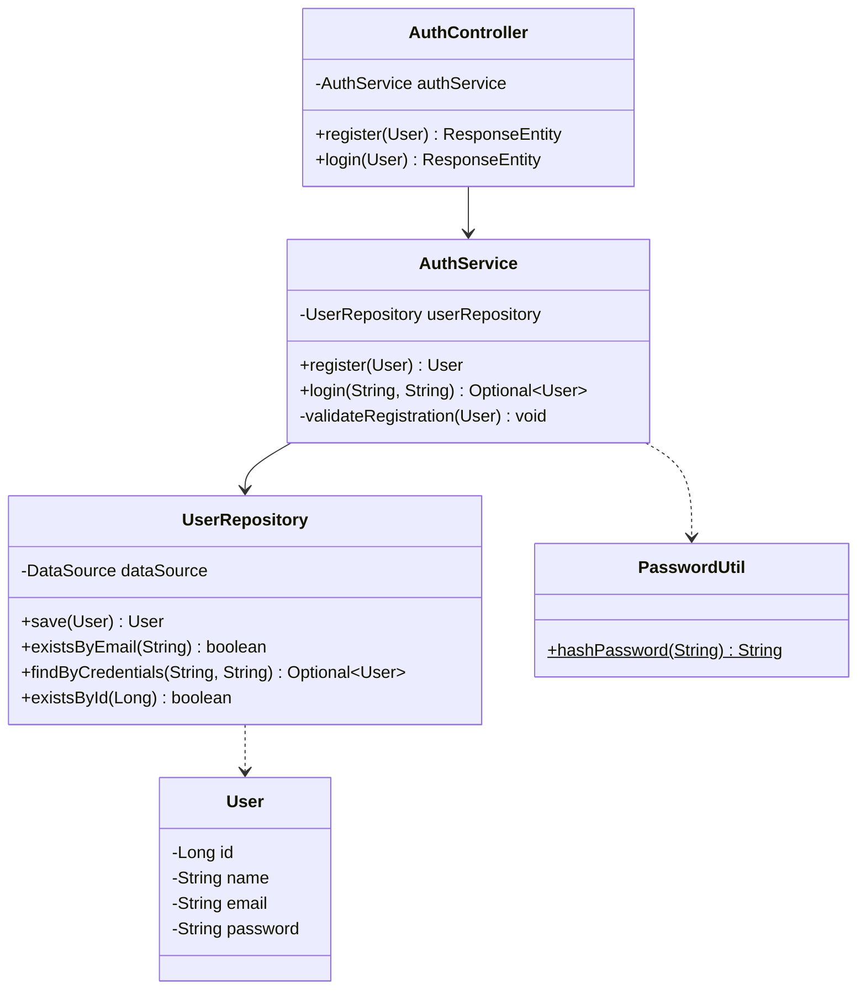

### 4.3 Carrito

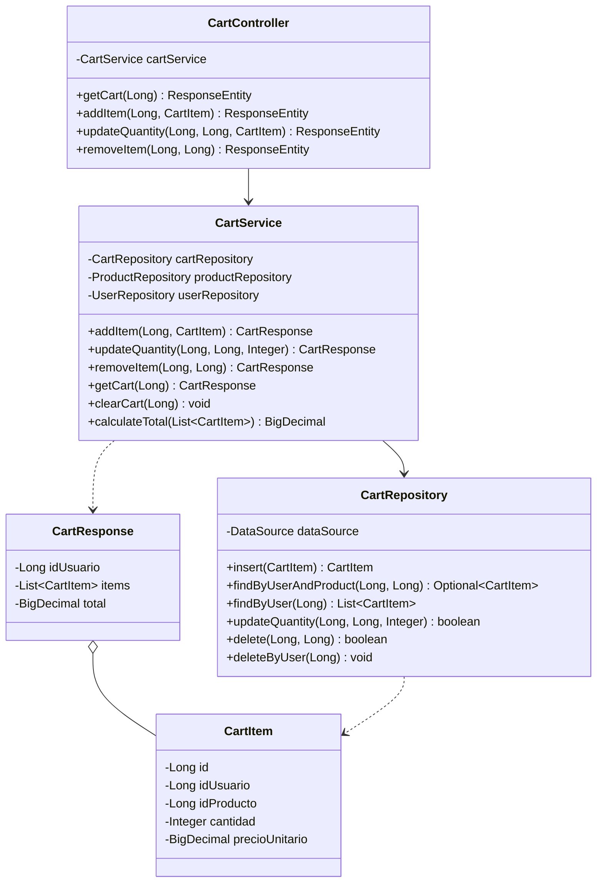

### 4.4 Pedidos

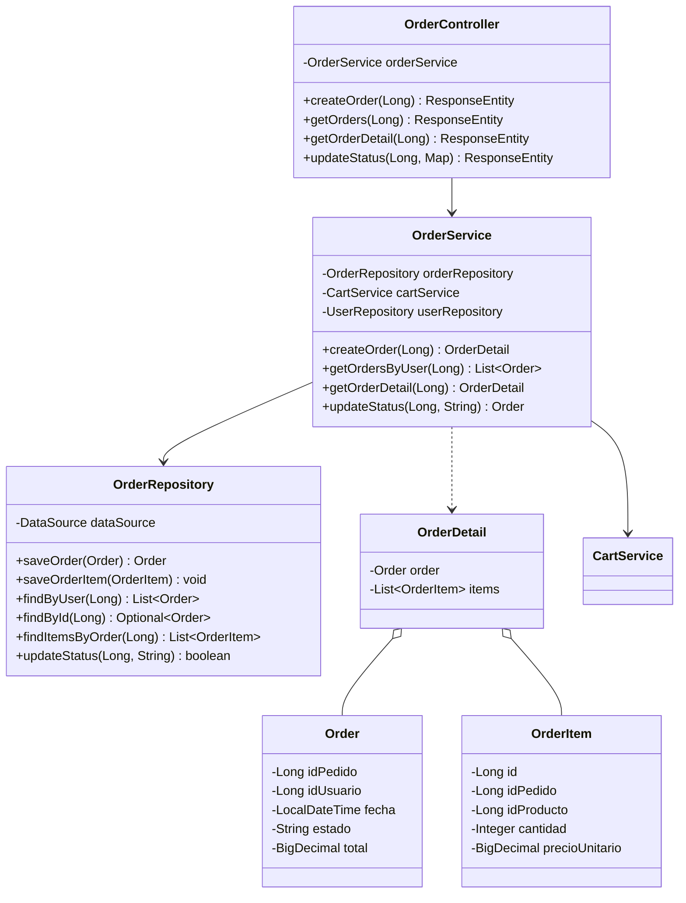

### 4.5 Manejo de errores (transversal)

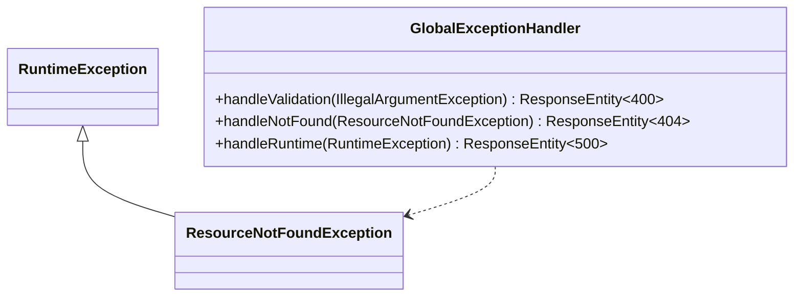

### 4.6 Módulos independientes

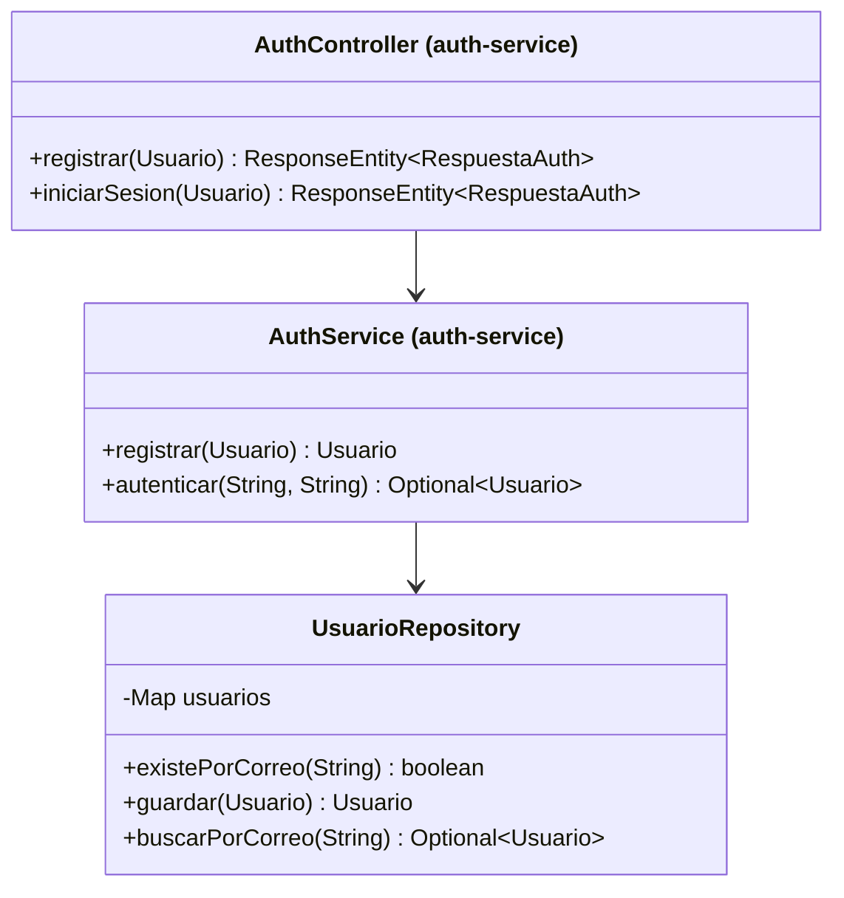

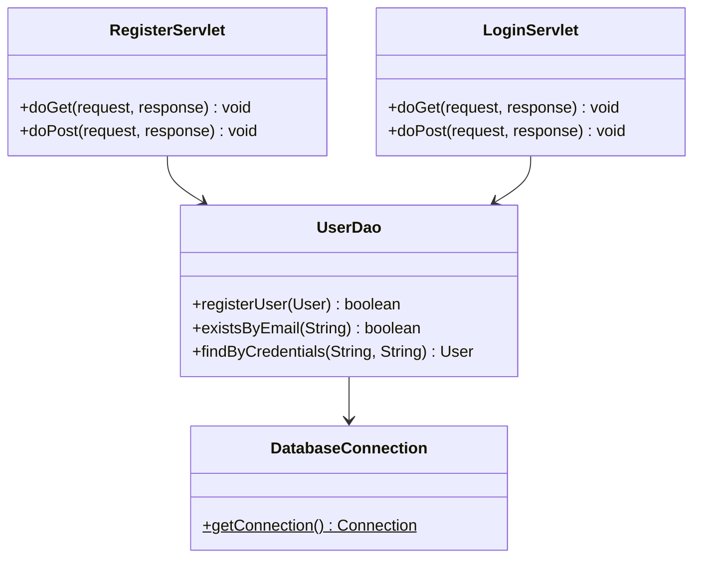

## 5. Mapa de navegación del frontend

Rutas reales definidas en `frontend/src/App.jsx` (React Router 6) y enlaces/redirecciones encontrados en el código.

| Ruta | Página | ¿Requiere sesión? | Cómo se llega |
|------|--------|-------------------|---------------|
| `/` | `Home` | No | Barra de navegación «Inicio»; tras iniciar sesión o cerrar sesión |
| `/catalogo` | `Catalogo` | No | «Productos»; botón «Ver catalogo» del Home |
| `/carrito` | `Cart` | Sí (si no hay sesión muestra «Inicia sesion para ver y gestionar tu carrito.») | «Carrito» |
| `/login` | `Login` | No | «Login»; al agregar al carrito sin sesión; tras registrarse |
| `/registro` | `Register` | No | «Registro»; enlace «Crear cuenta» |
| `/pedidos` | `Orders` | Sí (sin sesión pide iniciar sesión) | «Pedidos» (solo visible con sesión); tras «Finalizar compra» |
| `/pago` | `Checkout` | Sí (para pagar) | Solo escribiendo la URL: ningún enlace del código apunta a `/pago` |

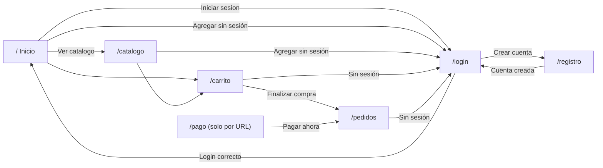

Capturas de las pantallas principales: [catálogo](capturas/01_catalogo.png), [login](capturas/02_login.png), [carrito](capturas/04_carrito.png), [pedido creado](capturas/05_pedido_creado.png), [historial](capturas/06_historial_pedidos.png).

### Estructura interna del frontend

| Carpeta | Contenido |
|---------|-----------|
| `pages/` | Home, Catalogo, Cart, Login, Register, Orders, Checkout |
| `components/` | Navbar, Footer, ProductCard, ProductList, SearchBar, CartSummary, OrderHistory, LoginForm, RegisterForm, LoginDrawer, Toast |
| `context/` | `AuthContext` (sesión en `localStorage`, clave `beautyshop_user`), `CartContext` (carrito sincronizado con el backend), `ToastContext` (avisos) |
| `services/` | `api.js` (instancia de axios con `baseURL: '/api'`), `productService`, `authService`, `cartService`, `orderService` |
| `utils/` | `format.js` (formato de moneda) |

## 6. Librerías y frameworks por capa (versiones reales)

| Capa | Librería / framework | Versión | Fuente de la versión |
|------|---------------------|---------|----------------------|
| Backend | Java (JDK) | 17 (OpenJDK 17.0.17 en el equipo de desarrollo) | `pom.xml` (`java.version`) |
| Backend | Spring Boot (parent) | 3.2.5 | `pom.xml` |
| Backend | Spring Framework (web, core, jdbc) | 6.1.6 | JAR generado |
| Backend | Tomcat embebido | 10.1.20 | JAR generado |
| Backend | Jackson (JSON) | 2.15.4 | JAR generado |
| Acceso a datos | `spring-boot-starter-jdbc` (`DataSource`) | 3.2.5 | `pom.xml` |
| Acceso a datos | HikariCP (en el classpath, ver §8) | 5.0.1 | JAR generado |
| Acceso a datos | `mysql-connector-j` | 8.3.0 | JAR generado |
| Documentación API | springdoc-openapi-starter-webmvc-ui | 2.5.0 | `pom.xml` |
| Documentación API | Swagger UI (webjar) | 5.13.0 | JAR generado |
| Pruebas backend | JUnit Jupiter (vía `spring-boot-starter-test`) | 5.10.2 | repositorio Maven local |
| Construcción | Maven (wrapper `./mvnw`) | 3.9.9 | `./mvnw -v` |
| Frontend | React / React DOM | 18.3.1 | `node_modules` instalado con `npm ci` |
| Frontend | React Router DOM | 6.30.4 | `node_modules` |
| Frontend | axios | 1.18.1 | `node_modules` |
| Frontend | Vite / `@vitejs/plugin-react` | 5.4.21 / 4.7.0 | `node_modules` |
| Pruebas e2e | `@playwright/test` (Chromium) | 1.62.0 | `node_modules` |
| Módulo web | Jakarta Servlet API / JSP API (provided) | 6.0.0 / 3.1.1 | `web-servlets-module/pom.xml` |
| Módulo web | Servidor Apache Tomcat | 10.1.61 (probado) | despliegue real, ver [DESPLIEGUE.md](DESPLIEGUE.md) |
| Módulo web | `maven-war-plugin` | 3.4.0 | `web-servlets-module/pom.xml` |
| Base de datos | MySQL Server | 9.5.0 (probado) | `SELECT VERSION();` |

## 7. Patrones de diseño usados

| Patrón | Dónde aparece |
|--------|---------------|
| **Arquitectura en capas / Service Layer** | Controlador → Servicio → Repositorio en todos los módulos (`ProductService`, `AuthService`, `CartService`, `OrderService`) |
| **Repository** | `ProductRepository`, `UserRepository`, `CartRepository`, `OrderRepository` encapsulan todo el SQL (JDBC + `PreparedStatement`) |
| **DAO** | `UserDao` en `web-servlets-module` (equivalente al repositorio, con `DriverManager`) |
| **MVC** | Backend: controladores REST + modelos; módulo web: Servlet (controlador) + JSP (vista) + `User` (modelo) |
| **DTO / objetos de transferencia** | `CartResponse`, `OrderDetail`, `RespuestaAuth` (auth-service) agrupan lo que se devuelve al cliente |
| **Inyección de dependencias / beans singleton** | Constructores con dependencias `final`; Spring crea un único bean por `@Service`, `@Repository`, `@RestController` y `@Configuration` |
| **Factory (método de fábrica de beans)** | `DatabaseConfig.dataSource()` (`@Bean`) construye el `DataSource` |
| **Singleton (utilidad estática)** | `PasswordUtil` y `DatabaseConnection`: clases `final` con constructor privado y métodos estáticos |
| **Manejo centralizado de excepciones** | `GlobalExceptionHandler` (`@RestControllerAdvice`) |
| **Context / Provider (React)** | `AuthProvider`, `CartProvider`, `ToastProvider` en `main.jsx`; hooks `useAuth`, `useCart`, `useToast` |
| **Componentes controlados y composición (React)** | `SearchBar`, `LoginForm`, `RegisterForm`; `Navbar`, `Footer` y rutas componen `App` |
| **Capa de servicios del cliente** | `frontend/src/services/*.js` aísla las llamadas HTTP de los componentes |
| **Proxy inverso de desarrollo** | `server.proxy` de Vite redirige `/api` al backend |

## 8. Mecanismos de seguridad (reales) y límites

### Lo que sí existe

| Mecanismo | Detalle | Dónde |
|-----------|---------|-------|
| Hash de contraseñas SHA-256 | La contraseña nunca se guarda en texto plano; se almacena el hash hexadecimal de 64 caracteres | `util/PasswordUtil`, `auth/AuthService`, tabla `users.password` |
| La contraseña no se devuelve | `AuthService.register` pone `password = null` en la respuesta (se verificó en la ejecución: `"password":null`) | `auth/AuthService` |
| Validación de entradas | Nombre/correo/contraseña obligatorios, precio ≥ 0, stock ≥ 0, cantidad > 0, estados de pedido permitidos | servicios |
| Precio tomado del servidor | Al agregar al carrito el precio unitario sale del producto en BD, no del cliente | `CartService.addItem` |
| Consultas parametrizadas | Todo el acceso a datos usa `PreparedStatement` (previene inyección SQL) | repositorios |
| Integridad referencial | Claves foráneas con `ON DELETE CASCADE`; correo único (`uk_users_email`) | `database/*.sql` |
| Manejo de errores | `400` validación, `404` no encontrado, `500` error inesperado, siempre con JSON `{"error": "..."}` | `GlobalExceptionHandler` |
| CORS | `@CrossOrigin(origins = "*")` en los controladores; el proxy de Vite evita CORS en desarrollo | controladores, `vite.config.js` |
| Validación en el cliente | Formato de correo y campos obligatorios en los formularios | `LoginForm`, `RegisterForm`, `Checkout` |

### Límites honestos (no implementado)

- **No hay JWT ni Spring Security.** El inicio de sesión devuelve los datos del usuario (`id`, `name`, `email`) pero **no emite token** ni sesión del lado del servidor.
- **Los endpoints no están protegidos:** cualquiera que conozca un `userId` puede consultar `/api/cart/{userId}` o `/api/orders/{userId}`, y los endpoints de productos (crear, editar, borrar) no exigen autenticación ni rol.
- **SHA-256 sin sal:** es un hash rápido y sin sal; sirve como ejercicio formativo, pero en producción debe usarse un algoritmo diseñado para contraseñas (BCrypt, Argon2).
- **CORS abierto (`*`)** en todos los controladores.
- **El frontend guarda al usuario en `localStorage`** y confía en él para decidir qué mostrar; la seguridad real tendría que estar en el servidor.
- **Sin HTTPS** en el entorno local; las credenciales de BD están en `application.properties` (en local, usuario `root` sin contraseña).
- **Sin control de inventario:** crear un pedido **no descuenta el stock** del producto (`OrderService` no lo hace) y no se comprueba stock al agregar al carrito.
- **Estados de pedido sin reglas de transición:** `PATCH /api/orders/{id}/status` acepta cualquiera de los 5 estados válidos desde cualquier estado.
- **Conexiones sin pool:** `DatabaseConfig` crea un `DriverManagerDataSource` (abre una conexión nueva por consulta). HikariCP está en el classpath por el starter, pero el bean explícito no lo usa.
- **Pago simulado:** la página `/pago` valida el formato de los datos de la tarjeta pero no los envía a ninguna pasarela; solo crea el pedido.
- El módulo `web-servlets-module` trae constantes de conexión con una contraseña por defecto; ahora acepta las variables de entorno `BEAUTYSHOP_DB_USER` y `BEAUTYSHOP_DB_PASSWORD` (ver [CONFIGURACION.md](CONFIGURACION.md)).
- El `auth-service` guarda usuarios solo en memoria: se pierden al reiniciar.

## 9. Metodología

- **Desarrollo incremental por evidencias**: cada guía del SENA se entregó como un incremento sobre el mismo repositorio (productos → autenticación → carrito/pedidos → frontend → servicios web → pruebas e integración).
- **Pruebas por módulo**: pruebas unitarias de los servicios con repositorios en memoria (JUnit 5), pruebas e2e del flujo de compra (Playwright) y colección Postman del servicio de autenticación.
- **Diseño primero en capas**: se escribe el modelo y el script SQL, luego repositorio, servicio y controlador, y al final la interfaz.
- **Control de versiones**: Git + GitHub.
- **Documentación continua**: Javadoc en el código, Swagger/OpenAPI para la API y los documentos de la carpeta `docs/`.

## 10. Estándares de codificación

Tomados del `README.md` del proyecto y aplicados en el código:

- Variables y métodos en `camelCase`; los métodos se nombran como verbos.
- Constantes en `UPPER_SNAKE_CASE` (`static final`).
- Clases e interfaces en `PascalCase`, un archivo `.java` por clase pública.
- Indentación de 4 espacios, llaves en la misma línea (Google Java Style), máximo 120 caracteres por línea.
- Javadoc en clases, métodos públicos y endpoints; comentarios y mensajes en español.
- Pruebas: una clase `XxxTest` por clase probada, métodos con nombres descriptivos y `@DisplayName` en español, repositorios falsos en memoria (sin Mockito).
- Frontend: componentes en `PascalCase.jsx`, funciones de servicio en `camelCase`, comentarios JSDoc en español.
