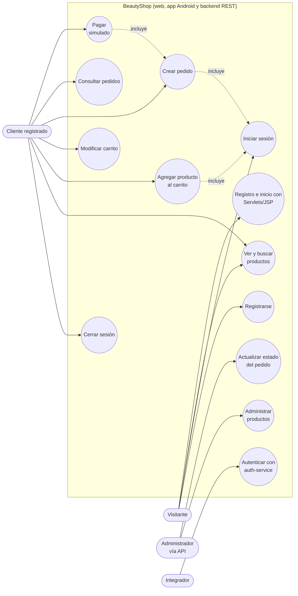

# Documento de requisitos — BeautyShop

Evidencias **GA8-220501096-AA1-EV01** y **AA1-EV02** · SENA — Análisis y Desarrollo de Software (ADSO), ficha 228118.

Este documento reúne los **requisitos funcionales**, los **requisitos no funcionales**, las **historias de usuario** y los **casos de uso** de BeautyShop. Todo se obtuvo del código y de la documentación real del proyecto; no se incluye ninguna función que el sistema no tenga. Para aprobar los requisitos se usa el formato de [ACTA_APROBACION_REQUISITOS.md](ACTA_APROBACION_REQUISITOS.md).

> Documentos relacionados: [MODULOS.md](MODULOS.md) · [MANUAL_TECNICO.md](MANUAL_TECNICO.md) · [INFORME_PRUEBAS.md](INFORME_PRUEBAS.md) · [App Android](../mobile-android/)

## 1. Introducción

### 1.1 Propósito

Definir qué debe hacer BeautyShop, una tienda en línea de maquillaje, y con qué evidencia (prueba automatizada o prueba manual) se comprueba cada requisito. Sirve de acuerdo entre el aprendiz y el instructor(a) o cliente.

### 1.2 Alcance

BeautyShop permite consultar un catálogo de productos, registrarse e iniciar sesión, armar un carrito, crear pedidos y ver el historial. El pago es **simulado**. Los componentes incluidos son:

| Componente | Carpeta | Descripción |
|------------|---------|-------------|
| Tienda web | `frontend/` | React 18 + Vite (puerto 4300) |
| Backend REST | `src/main/java/com/beautyshop/` | Spring Boot 3.2, Java 17, JDBC puro, MySQL (puerto 8090) |
| Servicio de autenticación | `auth-service/` | Microservicio Spring Boot con usuarios en memoria (puerto 8080) |
| Módulo Servlets/JSP | `web-servlets-module/` | Registro e inicio de sesión con Servlets y JSP, WAR en Tomcat 10.1 |
| App Android | `mobile-android/` | Kotlin + Jetpack Compose; consume el backend REST |

Fuera del alcance: pasarela de pago real, envíos, control de inventario al comprar, roles y permisos, recuperación de contraseña y panel de administración en pantalla (ver [Limitaciones conocidas](#7-limitaciones-conocidas)).

### 1.3 Actores

| Actor | Descripción | Capacidades reales |
|-------|-------------|--------------------|
| **Visitante** | Persona sin sesión iniciada | Ver catálogo, buscar productos, registrarse, iniciar sesión |
| **Cliente registrado** | Usuario con sesión iniciada | Todo lo del visitante, más carrito, pedidos, historial y pago simulado |
| **Administrador de la tienda** | Persona que gestiona productos y pedidos **a través de la API REST** (Swagger UI, Postman o curl) | Crear, actualizar y eliminar productos (`/api/products`); cambiar el estado de un pedido (`PATCH /api/orders/{id}/status`). **No existe rol ni pantalla de administración**: el sistema no distingue administradores de otros usuarios |
| **Aplicación cliente / integrador** | Quien consume `auth-service` | Registro y login por `POST /api/auth/register` y `/login` |

## 2. Requisitos funcionales

Prioridad: **Alta** = sin ella no hay tienda; **Media** = mejora importante; **Baja** = complementaria.
Las pruebas citadas están en [INFORME_PRUEBAS.md](INFORME_PRUEBAS.md) (backend 48, auth-service 8, e2e 7) y en las [pruebas unitarias de la app móvil](../mobile-android/app/src/test/) (85 pruebas). «Humo curl» = comprobación manual de la API del informe (sección 4); «manual» = prueba manual con evidencia indicada.

### 2.1 Autenticación

| ID | Nombre | Descripción | Prioridad | Implementado en | Prueba / evidencia |
|----|--------|-------------|-----------|-----------------|--------------------|
| RF-01 | Registro de usuario | El visitante crea una cuenta con nombre, correo y contraseña. El correo no puede repetirse. | Alta | `POST /api/auth/register` (`AuthController`, `AuthService`, `UserRepository`); web: `pages/Register`, `RegisterForm` | `AuthServiceTest` (register cifra la contraseña y no la devuelve, rechaza datos inválidos, rechaza correos duplicados); e2e `auth.spec.js` «registra un usuario nuevo y luego inicia sesion»; humo curl (201 y 400) |
| RF-02 | Inicio de sesión | El usuario entra con correo y contraseña. Si son correctos, el sistema devuelve sus datos (sin contraseña); si no, responde 401. | Alta | `POST /api/auth/login` (`AuthController`, `AuthService`); web: `pages/Login`, `LoginForm`, `AuthContext` | `AuthServiceTest` (login exitoso, contraseña incorrecta, campos vacíos); e2e `auth.spec.js` (registro → login → botón «Salir»); e2e `shop.spec.js` (login demo); humo curl (200 y 401) |
| RF-03 | Validación de los formularios web | Los formularios exigen todos los campos; el login valida el formato del correo; el registro exige contraseña de al menos 4 caracteres. | Media | `LoginForm`, `RegisterForm` (`MIN_PASSWORD_LENGTH = 4`) | e2e `auth.spec.js` «el login valida el formato del correo» y «el registro exige todos los campos» |
| RF-04 | Cierre de sesión | El usuario sale de su sesión; se borra del navegador/celular y deja de ver carrito y pedidos. | Media | Web: botón «Salir» (`Navbar`, `AuthContext.logout`); móvil: `AuthViewModel`, `AuthRepository.logout` | Móvil: `AuthRepositoryTest.cerrarSesionLimpiaUsuarioYCarrito`, `AuthAndCatalogViewModelTest.cerrarSesionQuitaElUsuario`. Web: solo se verifica que «Salir» aparece al iniciar sesión (e2e); el cierre en sí es prueba manual sin captura |
| RF-05 | Registro e inicio de sesión con Servlets/JSP | El módulo `web-servlets-module` registra e inicia sesión contra la tabla `users` y muestra «Hola, {nombre}!». | Media | `RegisterServlet` (`/register`), `LoginServlet` (`/login`), `UserDao`, `welcome.jsp`, `error.jsp` | Prueba manual en Tomcat 10.1.61 (INFORME_PRUEBAS §5, 5 comprobaciones); capturas `capturas/08_servlets_login.png` y `09_servlets_bienvenida.png` |
| RF-06 | Servicio de autenticación independiente | `auth-service` registra y autentica usuarios en memoria y responde `{mensaje, nombre, correo}`. | Baja | `auth-service`: `AuthController`, `AuthService`, `UsuarioRepository` | `AuthServiceTest` de auth-service (8); colección Postman `BeautyShop Auth` (5 solicitudes, 8 aserciones) |

### 2.2 Catálogo y productos

| ID | Nombre | Descripción | Prioridad | Implementado en | Prueba / evidencia |
|----|--------|-------------|-----------|-----------------|--------------------|
| RF-07 | Listar productos | El sistema muestra los productos con nombre, descripción, precio en pesos (COP), categoría y stock. | Alta | `GET /api/products` (`ProductController`, `ProductService.getAllProducts`); web: `pages/Home`, `pages/Catalogo`, `ProductList`, `ProductCard` | `ProductServiceTest` «getAllProducts devuelve la lista del repositorio»; e2e `home.spec.js` «muestra el hero y carga productos desde la API»; captura `capturas/01_catalogo.png` |
| RF-08 | Consultar un producto por id | Devuelve un producto o 404 si no existe. | Media | `GET /api/products/{id}` (`ProductController.getProductById`) | Humo curl (`/api/products/1` → 200, `/999` → 404); sin prueba unitaria específica |
| RF-09 | Buscar productos por nombre | El buscador de la web filtra la lista por nombre mientras se escribe. | Media | `SearchBar`, `pages/Home` | e2e `home.spec.js` «el buscador filtra los productos por nombre» |
| RF-10 | Catálogo con foto del producto | El catálogo muestra la foto de cada producto, servida por el backend en `/images/{archivo}`; el campo `image` del producto guarda el nombre del archivo. | Media | Backend: recurso estático `src/main/resources/static/images/`; campo `Product.image`; web: `ProductCard` + `productImageUrl` (`utils/format.js`); app: `ImageUrls.productImage` + Coil en catálogo y detalle | Móvil: `ImageUrlsTest` (5: vacía, nombre de archivo, URL absoluta, base con y sin "/", barra inicial). Web: sin prueba automatizada; verificado en navegador (las 5 fotos cargan desde `/images/`). Capturas `capturas/01_catalogo.png`, `mobile-android/docs/capturas/04-catalogo.png` y `06-detalle-producto.png`. Créditos en [CREDITOS_IMAGENES.md](CREDITOS_IMAGENES.md) |
| RF-11 | Administrar productos (API) | El administrador crea, actualiza y elimina productos. Nombre obligatorio, precio y stock no negativos. | Media | `POST/PUT/DELETE /api/products` (`ProductController`, `ProductService`, `ProductRepository`) | `ProductServiceTest` (8: crear válido, nombre vacío, precio negativo, stock negativo, actualizar existente/inexistente, eliminar); humo curl (201, 400, 200, 404, 204) |

### 2.3 Carrito

| ID | Nombre | Descripción | Prioridad | Implementado en | Prueba / evidencia |
|----|--------|-------------|-----------|-----------------|--------------------|
| RF-12 | Agregar producto al carrito | El cliente agrega un producto con una cantidad mayor que 0. El precio se toma siempre del producto; si ya estaba, se suman las cantidades. | Alta | `POST /api/cart/{userId}/items` (`CartController`, `CartService.addItem`); web: botón «Agregar» en `Home`/`Catalogo`, `CartContext` | `CartServiceTest` (`addItem` ×7: línea nueva, suma de cantidades, cantidad 0/negativa/nula, producto o usuario inexistente); e2e `shop.spec.js` (agregar al carrito) |
| RF-13 | Ver el carrito y su total | Lista las líneas y calcula el total como suma de precio unitario × cantidad. | Alta | `GET /api/cart/{userId}` (`CartService.getCart`, `CartResponse`); web: `pages/Cart`, `CartSummary` | `CartServiceTest` (`getCart` vacío, usuario inexistente, `calculateTotal`); e2e `shop.spec.js` (botón «Finalizar compra» visible) |
| RF-14 | Cambiar la cantidad de un producto | Reemplaza la cantidad (debe ser mayor que 0) y recalcula el total. | Media | `PUT /api/cart/{userId}/items/{productId}` (`CartService.updateQuantity`); `CartSummary` | `CartServiceTest` (`updateQuantity` ×3); humo curl (200) |
| RF-15 | Quitar un producto del carrito | Elimina la línea del producto; 404 si no estaba. | Media | `DELETE /api/cart/{userId}/items/{productId}` (`CartService.removeItem`); `CartSummary` | `CartServiceTest` (`removeItem` ×2, `clearCart`); humo curl (200 y 404) |
| RF-16 | Carrito solo con sesión iniciada | Sin sesión, la web pide iniciar sesión y no deja agregar productos. | Alta | Web: `pages/Cart`, `Home`/`Catalogo` (redirigen a `/login`); móvil: `CartRepository` | e2e `shop.spec.js` «el carrito pide iniciar sesion si no hay usuario»; móvil `ProductAndCartRepositoryTest.carritoSinSesionPideIniciarSesion` |

### 2.4 Pedidos

| ID | Nombre | Descripción | Prioridad | Implementado en | Prueba / evidencia |
|----|--------|-------------|-----------|-----------------|--------------------|
| RF-17 | Crear pedido desde el carrito | Convierte el carrito en un pedido en estado `pendiente` con el total del carrito, copia las líneas y vacía el carrito. No se puede crear con el carrito vacío. | Alta | `POST /api/orders/{userId}` (`OrderController`, `OrderService.createOrder`, `OrderRepository`); web: «Finalizar compra» (`pages/Cart`) | `OrderServiceTest` (`createOrder` ×5); e2e `shop.spec.js` (finalizar → `/pedidos`); humo curl (201 y 400); captura `capturas/05_pedido_creado.png` |
| RF-18 | Historial de pedidos | El cliente ve sus pedidos con número, fecha, estado y total. | Alta | `GET /api/orders/{userId}` (`OrderService.getOrdersByUser`); web: `pages/Orders`, `OrderHistory` | `OrderServiceTest` (`getOrdersByUser` ×3); e2e `shop.spec.js` («Pedido #N»); captura `capturas/06_historial_pedidos.png` |
| RF-19 | Detalle de un pedido | Muestra la cabecera y las líneas (producto, cantidad, precio unitario). | Media | `GET /api/orders/detail/{orderId}` (`OrderService.getOrderDetail`, `OrderDetail`) | `OrderServiceTest` (`getOrderDetail` ×2); humo curl (200 y 404) |
| RF-20 | Cambiar el estado de un pedido (API) | El administrador cambia el estado a `pendiente`, `pagado`, `enviado`, `entregado` o `cancelado`. El estado se normaliza a minúscula y sin espacios. | Media | `PATCH /api/orders/{orderId}/status` (`OrderController`, `OrderService.updateStatus`) | `OrderServiceTest` (`updateStatus` ×4); humo curl (200, 400, 404). Ninguna pantalla web ni móvil usa este endpoint |

### 2.5 Pago simulado

| ID | Nombre | Descripción | Prioridad | Implementado en | Prueba / evidencia |
|----|--------|-------------|-----------|-----------------|--------------------|
| RF-21 | Pago simulado | La página `/pago` pide nombre, correo, dirección y datos de tarjeta ficticios, valida el formato y, si es correcto, crea el pedido real y muestra «Pago autorizado». **No se envía ningún dato a una pasarela.** | Baja | `pages/Checkout` (`/pago`), que llama a `createOrder` → `POST /api/orders/{userId}` | **Sin prueba e2e ni captura.** El pedido que crea está cubierto por `OrderServiceTest`. La validación de tarjeta es solo prueba manual. La página solo se abre escribiendo la URL (ningún enlace apunta a ella) |

### 2.6 App móvil Android

| ID | Nombre | Descripción | Prioridad | Implementado en | Prueba / evidencia |
|----|--------|-------------|-----------|-----------------|--------------------|
| RF-22 | Autenticación en la app | Registro e inicio de sesión; el registro exige nombre, correo válido y contraseña de al menos 6 caracteres; la sesión se conserva en el equipo (sin guardar la contraseña). | Alta | `ui.auth.AuthScreen`, `AuthViewModel`, `AuthRepository`, `SessionManager` | `AuthRepositoryTest` (10), `AuthAndCatalogViewModelTest` (login/registro); manual: capturas `mobile-android/docs/capturas/01-inicio-sesion.png`, `02-error-credenciales.png`, `03-registro.png` |
| RF-23 | Catálogo, búsqueda, filtro y detalle | Lista de productos, búsqueda por nombre o categoría (sin distinguir tildes), filtro por categoría y pantalla de detalle con cantidad. | Alta | `ui.catalog.CatalogScreen`, `ProductDetailScreen`, `CatalogViewModel`, `ProductRepository`, `ProductFilter` | `FormattersAndFilterTest` (filtros), `AuthAndCatalogViewModelTest` (carga, búsqueda, categoría, reintento, detalle), `ProductAndCartRepositoryTest` (mapeo y caché); capturas `04-catalogo.png`, `05-busqueda.png`, `06-detalle-producto.png` |
| RF-24 | Carrito en la app | Agregar, aumentar, disminuir y quitar productos; cantidad mínima 1 y máxima el menor entre el stock y 99; total en pesos. | Alta | `ui.cart.CartScreen`, `CartViewModel`, `CartRepository` | `ProductAndCartRepositoryTest` (13), `CartAndOrdersViewModelTest` (carrito); capturas `07-producto-agregado.png`, `09-carrito.png` |
| RF-25 | Pedidos en la app | Crear el pedido con el carrito, ver el historial (más reciente primero) y el detalle. | Alta | `ui.orders.OrderHistoryScreen`, `OrderDetailScreen`, `OrdersViewModels`, `OrderRepository` | `OrderRepositoryTest` (8), `CartAndOrdersViewModelTest` (crear pedido, historial, detalle); capturas `10-detalle-pedido.png`, `11-historial-pedidos.png`, `12-carrito-vacio.png` |

**Total: 25 requisitos funcionales** (RF-01 a RF-25).

## 3. Requisitos no funcionales

| ID | Categoría | Requisito | Implementado en | Verificación |
|----|-----------|-----------|-----------------|--------------|
| RNF-01 | Seguridad | Las contraseñas se guardan con hash SHA-256 (64 caracteres hexadecimales) y **nunca** se devuelven en las respuestas (`password: null`). | `PasswordUtil.hashPassword`, `AuthService` | `PasswordUtilTest` (4), `AuthServiceTest` «register cifra la contrasena y no la devuelve»; Postman «el body NO contiene contraseña» |
| RNF-02 | Seguridad / validación | Se validan las entradas: nombre, correo y contraseña obligatorios; precio, stock y cantidad con valores válidos; estados de pedido dentro de la lista permitida. La validación está en los servicios (backend), en los formularios web y en la app. | `ProductService`, `AuthService`, `CartService`, `OrderService`, `LoginForm`, `RegisterForm`, `AuthRepository.validateRegistration` | Pruebas unitarias de cada servicio; e2e `auth.spec.js`; `AuthRepositoryTest` |
| RNF-03 | Seguridad | Las consultas SQL usan `PreparedStatement` con parámetros, no concatenan texto del usuario. | Repositorios JDBC (`ProductRepository`, `UserRepository`, `CartRepository`, `OrderRepository`, `UserDao`) | Revisión de código (no hay prueba automatizada) |
| RNF-04 | Fiabilidad | Los errores del backend principal tienen formato uniforme `{"error": "mensaje"}` con estado 400, 404 o 500. | `GlobalExceptionHandler` | Humo curl (33 llamadas con los códigos esperados); [MODULOS.md](MODULOS.md) |
| RNF-05 | Seguridad (móvil) | La app no guarda la contraseña, no muestra detalles internos en errores 5xx, no registra cuerpos de peticiones y solo permite HTTP sin cifrar hacia `10.0.2.2` y `localhost`. | `SessionManager`, `ApiErrorMapper`, `ApiClient`, `res/xml/network_security_config.xml` | `ApiErrorMapperTest` (10); revisión de configuración |
| RNF-06 | Usabilidad | Interfaz y mensajes en español; precios en pesos colombianos con punto de miles; la app móvil muestra estados de carga, vacío y error y traduce los errores de red. | `frontend/src/utils/format.js`, `Toast`; móvil: `Formatters`, `ApiErrors` | `FormattersAndFilterTest`, `ApiErrorMapperTest`; e2e con mensajes visibles; capturas web y móvil |
| RNF-07 | Usabilidad | La tienda web se adapta a pantallas pequeñas: la rejilla de productos reduce sus columnas hasta una sola y el carrito, el pago, el hero y la barra de navegación se reorganizan con `@media` (1100, 900, 850 y 640 px). | `index.css`, `Cart.css`, `Checkout.css`, `Home.css`, `Navbar.css`, `CartSummary.css` | Revisión de CSS. **No hay prueba automatizada ni capturas en tamaño móvil** |
| RNF-08 | Portabilidad | Backend y módulos Java compilan con **JDK 17** (`java.version = 17`); la app Android funciona en **Android 8.0 o superior** (`minSdk = 26`, `targetSdk = 35`, `compileSdk = 35`); base de datos MySQL 8 o superior (probado con 9.5). | `pom.xml`; `mobile-android/app/build.gradle.kts` | Compilación y pruebas en JDK 17.0.17 (INFORME_PRUEBAS); APK probado en emulador Android 15 (API 35). Android 8–14 no se probó |
| RNF-09 | Mantenibilidad | Arquitectura por capas (controlador → servicio → repositorio) en el backend, MVVM con repositorios en la app y estándares de código: `camelCase`, `PascalCase`, 4 espacios, máx. 120 caracteres, Javadoc/KDoc. | Paquetes `controller`, `service`, `repository`, `model`; `mobile-android` (`ui`, `domain`, `data`) | Revisión de código; [MANUAL_TECNICO.md](MANUAL_TECNICO.md) |
| RNF-10 | Compatibilidad | La tienda web funciona en un navegador moderno de escritorio. **Solo se probó en Chromium** (Playwright, `Desktop Chrome`). | `frontend/playwright.config.js` | e2e 7 de 7 en Chromium; Firefox, Safari y Edge no se probaron |
| RNF-11 | Rendimiento | En ejecución local el catálogo se descarga una vez y la búsqueda se hace en memoria; la app móvil usa tiempos de espera de 15 s de conexión y 15 s de lectura. | `Home.jsx` (filtro local); `ApiClient`; `ProductRepository` (caché) | `ProductAndCartRepositoryTest` (caché). **No se midieron tiempos de respuesta ni se hizo prueba de carga** |
| RNF-12 | Documentación | La API se documenta con OpenAPI: Swagger UI en `/swagger-ui.html` y especificación en `/v3/api-docs`, con los grupos Autenticación, Carrito, Pedidos y Productos. | `springdoc-openapi-starter-webmvc-ui 2.5.0`, anotaciones `@Tag` | Humo curl (302 y 200); captura `capturas/07_swagger_ui.png` |

**Total: 12 requisitos no funcionales** (RNF-01 a RNF-12).

## 4. Historias de usuario

Estimación en puntos de historia (escala 1, 2, 3, 5, 8). Los criterios usan los mensajes reales del sistema.

### HU-01 — Registrarme en la tienda

**Como** visitante, **quiero** crear una cuenta con mi nombre, correo y contraseña, **para** poder comprar y guardar mi carrito. · Prioridad: Alta · Estimación: 3 · RF: RF-01, RF-03

- **Dado** que estoy en el registro y los datos son válidos, **cuando** envío el formulario, **entonces** la cuenta se crea (`201`), la respuesta no incluye mi contraseña y la web me lleva a `/login`.
- **Dado** que dejo algún campo vacío, **cuando** envío el formulario, **entonces** veo «Todos los campos son obligatorios.».
- **Dado** que el correo ya existe, **cuando** envío el formulario, **entonces** el sistema responde `400` con «El correo ya esta registrado.».
- **Dado** que uso la app móvil con una contraseña de menos de 6 caracteres, **cuando** me registro, **entonces** veo «La contraseña debe tener al menos 6 caracteres.».

### HU-02 — Iniciar sesión

**Como** cliente registrado, **quiero** iniciar sesión con mi correo y contraseña, **para** acceder a mi carrito y a mis pedidos. · Prioridad: Alta · Estimación: 3 · RF: RF-02, RF-03

- **Dado** que mis credenciales son correctas, **cuando** entro, **entonces** veo mi nombre y el botón «Salir», y la sesión se mantiene al recargar.
- **Dado** que la contraseña es incorrecta, **cuando** intento entrar, **entonces** el backend responde `401` con «Correo o contrasena incorrectos.» (la app móvil muestra «Correo o contraseña incorrectos.»).
- **Dado** que escribo un correo sin formato válido en la web, **cuando** intento entrar, **entonces** veo «El correo no tiene un formato valido.».
- **Dado** que dejo vacíos el correo y la contraseña, **cuando** intento entrar, **entonces** veo «Debes ingresar correo y contrasena.» (backend) o «Ingresa tu correo y tu contraseña.» (app).

### HU-03 — Cerrar sesión

**Como** cliente registrado, **quiero** cerrar mi sesión, **para** que nadie use mi cuenta en un equipo compartido. · Prioridad: Media · Estimación: 1 · RF: RF-04

- **Dado** que tengo sesión iniciada, **cuando** pulso «Salir», **entonces** desaparece mi usuario y vuelven los enlaces «Login» y «Registro».
- **Dado** que cierro sesión en la app, **cuando** vuelvo a la pantalla principal, **entonces** el carrito local queda vacío y debo iniciar sesión otra vez.

### HU-04 — Ver el catálogo con fotos

**Como** visitante, **quiero** ver los productos con su foto, precio y categoría, **para** decidir qué comprar. · Prioridad: Alta · Estimación: 3 · RF: RF-07, RF-10

- **Dado** que el backend está en ejecución, **cuando** abro el inicio o «Productos», **entonces** veo la lista con nombre, descripción y precio en pesos colombianos.
- **Dado** que un producto tiene foto, **cuando** se muestra su tarjeta, **entonces** aparece la imagen servida por el backend en `/images/{archivo}`.
- **Dado** que el backend no responde, **cuando** abro la app móvil, **entonces** veo un mensaje de error y puedo reintentar.

### HU-05 — Buscar productos

**Como** visitante, **quiero** buscar productos por nombre, **para** encontrar rápido lo que necesito. · Prioridad: Media · Estimación: 2 · RF: RF-09, RF-23

- **Dado** que estoy en el inicio, **cuando** escribo «rubor», **entonces** se muestra «Rubor en Polvo Coral» y se oculta «Labial Mate Rojo Pasion».
- **Dado** que uso la app, **cuando** busco «mascara», **entonces** encuentra el producto aunque tenga tilde, y puedo combinar la búsqueda con una categoría.
- **Dado** que ningún producto coincide, **cuando** busco, **entonces** la lista queda vacía.

### HU-06 — Agregar un producto al carrito

**Como** cliente registrado, **quiero** agregar productos a mi carrito, **para** comprarlos juntos. · Prioridad: Alta · Estimación: 3 · RF: RF-12, RF-16

- **Dado** que tengo sesión, **cuando** pulso «Agregar», **entonces** veo «{producto} agregado al carrito» y la insignia del carrito aumenta.
- **Dado** que el producto ya estaba en el carrito, **cuando** lo agrego otra vez, **entonces** se suman las cantidades en una sola línea.
- **Dado** que no tengo sesión, **cuando** pulso «Agregar», **entonces** veo «Inicia sesion para agregar al carrito.» y la web me lleva a `/login`.
- **Dado** que envío cantidad 0, **cuando** la API procesa la solicitud, **entonces** responde `400` «La cantidad debe ser mayor que 0.».
- **Dado** que el producto no existe, **cuando** lo agrego, **entonces** responde `404` «El producto 999 no existe.».

### HU-07 — Modificar mi carrito

**Como** cliente registrado, **quiero** cambiar cantidades o quitar productos, **para** ajustar mi compra antes de pagar. · Prioridad: Media · Estimación: 3 · RF: RF-13, RF-14, RF-15

- **Dado** que mi carrito tiene productos, **cuando** lo abro, **entonces** veo cada línea y el total (suma de precio × cantidad).
- **Dado** que cambio una cantidad a un valor válido, **cuando** confirmo, **entonces** el total se recalcula.
- **Dado** que quito un producto, **cuando** confirmo, **entonces** la línea desaparece; si el producto no estaba, la API responde `404` «El producto 3 no esta en el carrito.».
- **Dado** que uso la app, **cuando** intento superar el stock, **entonces** veo «Solo puedes pedir hasta N unidades de este producto.».
- **Dado** que no tengo sesión en la web, **cuando** abro `/carrito`, **entonces** veo «Inicia sesion para ver y gestionar tu carrito.».

### HU-08 — Crear un pedido

**Como** cliente registrado, **quiero** finalizar mi compra, **para** que mi carrito se convierta en un pedido. · Prioridad: Alta · Estimación: 5 · RF: RF-17

- **Dado** que mi carrito tiene productos, **cuando** pulso «Finalizar compra», **entonces** se crea un pedido en estado `pendiente` con el total del carrito, el carrito queda vacío y la web me lleva a `/pedidos`.
- **Dado** que mi carrito está vacío, **cuando** intento crear el pedido, **entonces** veo «El carrito esta vacio; no se puede crear el pedido.» (app: «Tu carrito está vacío. Agrega productos antes de hacer el pedido.»).
- **Dado** que falla la conexión en la app, **cuando** creo el pedido, **entonces** el carrito se conserva.

### HU-09 — Consultar mis pedidos

**Como** cliente registrado, **quiero** ver mi historial y el detalle de cada pedido, **para** saber qué compré y en qué estado está. · Prioridad: Alta · Estimación: 3 · RF: RF-18, RF-19

- **Dado** que tengo pedidos, **cuando** abro «Pedidos», **entonces** veo tarjetas «Pedido #N» con fecha, estado y total (en la app, el más reciente primero).
- **Dado** que no tengo pedidos, **cuando** abro el historial, **entonces** la lista aparece vacía.
- **Dado** que consulto un pedido inexistente, **cuando** pido su detalle, **entonces** la API responde `404` «El pedido 9999 no existe.».

### HU-10 — Pagar con tarjeta (simulado)

**Como** cliente registrado, **quiero** llenar un formulario de pago, **para** confirmar mi compra. · Prioridad: Baja · Estimación: 3 · RF: RF-21

- **Dado** que estoy en `/pago` con sesión, **cuando** completo todos los datos con formato válido y pulso pagar, **entonces** se crea el pedido, veo «✅ Pago autorizado. ¡Gracias por tu compra!» y me lleva a `/pedidos`.
- **Dado** que dejo campos vacíos, **cuando** pago, **entonces** veo «Completa todos los campos.».
- **Dado** que el correo, la tarjeta (mínimo 15 dígitos), el vencimiento `MM/AA` o el CVV (3 dígitos) son inválidos, **cuando** pago, **entonces** veo «Correo invalido.» o «Revisa los datos de la tarjeta.».
- **Dado** que no tengo sesión, **cuando** pago, **entonces** veo «Inicia sesion para finalizar la compra.».
- Nota: el pago es una simulación; no se cobra ni se envía información a una pasarela.

### HU-11 — Administrar los productos

**Como** administrador de la tienda, **quiero** crear, actualizar y eliminar productos mediante la API, **para** mantener el catálogo al día. · Prioridad: Media · Estimación: 5 · RF: RF-08, RF-11

- **Dado** que envío un producto válido a `POST /api/products`, **cuando** se procesa, **entonces** responde `201` con el producto y su `id`.
- **Dado** que el nombre está vacío, **cuando** lo envío, **entonces** responde `400` «El nombre del producto es obligatorio.».
- **Dado** que el precio o el stock son negativos, **cuando** lo envío, **entonces** responde `400` (mensajes del servicio: «El precio debe ser un valor positivo.», «El stock no puede ser negativo.»).
- **Dado** que actualizo o elimino un `id` inexistente, **cuando** se procesa, **entonces** responde `404`; al eliminar uno existente responde `204`.

### HU-12 — Actualizar el estado de un pedido

**Como** administrador de la tienda, **quiero** cambiar el estado de un pedido mediante la API, **para** reflejar su avance. · Prioridad: Media · Estimación: 2 · RF: RF-20

- **Dado** que existe el pedido 9, **cuando** envío `{"estado":"pagado"}` a `PATCH /api/orders/9/status`, **entonces** responde `200` con el estado actualizado.
- **Dado** que envío un estado no permitido, **cuando** se procesa, **entonces** responde `400` «Estado invalido. Validos: [...]».
- **Dado** que el pedido no existe, **cuando** se procesa, **entonces** responde `404`.

### HU-13 — Comprar desde el celular

**Como** cliente registrado, **quiero** usar la app Android para ver productos, armar el carrito y crear pedidos, **para** comprar desde mi celular. · Prioridad: Alta · Estimación: 8 · RF: RF-22, RF-23, RF-24, RF-25

- **Dado** que instalo el APK y el backend está en ejecución, **cuando** me registro o inicio sesión, **entonces** entro al catálogo.
- **Dado** que veo un producto, **cuando** abro su detalle y elijo cantidad, **entonces** puedo agregarlo al carrito sin superar el stock.
- **Dado** que mi carrito tiene productos, **cuando** creo el pedido, **entonces** veo el número del pedido, el carrito queda vacío y el pedido aparece en el historial.
- **Dado** que no hay red, **cuando** realizo cualquier acción, **entonces** veo un mensaje de conexión en español en lugar de detalles técnicos.

### HU-14 — Registrarme e iniciar sesión en el módulo Servlets/JSP

**Como** visitante, **quiero** usar los formularios del módulo Servlets/JSP, **para** crear mi cuenta y entrar con la misma tabla de usuarios. · Prioridad: Media · Estimación: 3 · RF: RF-05

- **Dado** que envío un registro válido, **cuando** el servlet lo procesa, **entonces** redirige (`302`) a `login.html?registered=true`.
- **Dado** que mis credenciales son correctas, **cuando** inicio sesión, **entonces** veo «Hola, {nombre}!».
- **Dado** que la contraseña es incorrecta o el correo ya existe, **cuando** envío el formulario, **entonces** `error.jsp` muestra «Correo o contrasena incorrectos.» o «El correo ya esta registrado.».

### HU-15 — Usar el servicio de autenticación independiente

**Como** integrador, **quiero** registrar y autenticar usuarios con `auth-service`, **para** reutilizar la autenticación sin base de datos. · Prioridad: Baja · Estimación: 2 · RF: RF-06

- **Dado** que envío un registro válido, **cuando** el servicio lo procesa, **entonces** responde `201` «Usuario registrado exitosamente» sin devolver la contraseña.
- **Dado** que el correo ya existe o hay campos vacíos, **cuando** se procesa, **entonces** responde `400` «El correo ya esta registrado.» o «Todos los campos son obligatorios.».
- **Dado** que la contraseña es incorrecta, **cuando** inicio sesión, **entonces** responde `401` «Autenticacion fallida: credenciales invalidas».

**Total: 15 historias de usuario** (HU-01 a HU-15).

## 5. Casos de uso

### 5.1 Diagrama general

El cliente registrado hereda lo que hace el visitante (registrarse, iniciar sesión, ver productos).

### 5.2 CU-01 — Iniciar sesión

| Campo | Descripción |
|-------|-------------|
| Actor | Visitante (se convierte en cliente registrado) |
| Requisitos | RF-02, RF-03, RNF-01 |
| Precondiciones | El visitante tiene una cuenta registrada; el backend y MySQL están en ejecución |
| Flujo principal | 1. El visitante abre `/login` (o la pantalla de acceso de la app). 2. Escribe correo y contraseña. 3. La interfaz valida que el correo tenga formato válido y que no haya campos vacíos. 4. Envía `POST /api/auth/login`. 5. El backend calcula el SHA-256 de la contraseña y busca el usuario por correo y hash. 6. El backend responde `200` con `id`, `name`, `email` y `password: null`. 7. La interfaz guarda el usuario (`localStorage` en la web; preferencias privadas en la app), muestra «Salir» y redirige a `/`. |
| Flujos alternos | **A1. Campos vacíos:** el backend responde `400` «Debes ingresar correo y contrasena.»; la app lo detecta antes con «Ingresa tu correo y tu contraseña.». **A2. Correo con formato inválido (web):** «El correo no tiene un formato valido.»; no se envía la petición. **A3. Credenciales incorrectas:** `401` «Correo o contrasena incorrectos.»; la sesión no se inicia. **A4. Sin conexión:** la app muestra un mensaje de conexión; la web no inicia sesión. |
| Postcondiciones | Éxito: hay un usuario en sesión y puede usar carrito y pedidos. Fallo: no hay sesión y no cambia ningún dato. |
| Pruebas | `AuthServiceTest` (login exitoso, contraseña incorrecta, campos vacíos); e2e `auth.spec.js` y `shop.spec.js`; `AuthRepositoryTest` (móvil) |

### 5.3 CU-02 — Agregar producto al carrito

| Campo | Descripción |
|-------|-------------|
| Actor | Cliente registrado |
| Requisitos | RF-12, RF-16, RNF-02 |
| Precondiciones | El cliente tiene sesión iniciada; el producto existe en el catálogo |
| Flujo principal | 1. El cliente ve un producto en el inicio, en «Productos» o en el detalle (app). 2. Pulsa «Agregar». 3. El cliente envía `POST /api/cart/{userId}/items` con `{idProducto, cantidad}`. 4. `CartService` verifica que el usuario y el producto existan y que la cantidad sea mayor que 0. 5. Toma el precio unitario del producto (ignora cualquier precio enviado por el cliente). 6. Inserta la línea en `cart_items`. 7. Responde `201` con el carrito y el total. 8. La interfaz muestra «{producto} agregado al carrito» y actualiza la insignia. |
| Flujos alternos | **A1. Producto ya en el carrito:** `CartService` suma la cantidad a la línea existente; no crea una línea nueva. **A2. Sin sesión:** la web muestra «Inicia sesion para agregar al carrito.» y va a `/login`; la app muestra «Inicia sesión para usar el carrito.». **A3. Cantidad 0, negativa o nula:** `400` «La cantidad debe ser mayor que 0.». **A4. Producto inexistente:** `404` «El producto 999 no existe.». **A5. Usuario inexistente:** `404` «El usuario 99999 no existe.». **A6. En la app, cantidad mayor que el stock o 99:** «Solo puedes pedir hasta N unidades de este producto.» sin llamar al servidor. |
| Postcondiciones | Éxito: el carrito del usuario en la base de datos incluye el producto con la cantidad indicada y el total actualizado. Fallo: el carrito no cambia. |
| Pruebas | `CartServiceTest` (`addItem` ×7); e2e `shop.spec.js`; `ProductAndCartRepositoryTest` (móvil) |

### 5.4 CU-03 — Crear pedido

| Campo | Descripción |
|-------|-------------|
| Actor | Cliente registrado |
| Requisitos | RF-17, RF-18, RF-21 (si se paga desde `/pago`) |
| Precondiciones | El cliente tiene sesión iniciada y al menos un producto en el carrito |
| Flujo principal | 1. El cliente abre el carrito y revisa el total. 2. Pulsa «Finalizar compra» (en la app, «crear pedido»). 3. El cliente envía `POST /api/orders/{userId}`. 4. `OrderService` verifica que el usuario exista y obtiene el carrito y su total con `CartService.getCart`. 5. Crea el pedido en estado `pendiente` con la fecha y el total. 6. Copia cada línea del carrito (producto, cantidad, precio unitario) al pedido. 7. Vacía el carrito del usuario. 8. Responde `201` con la cabecera y las líneas. 9. La interfaz muestra «¡Pedido creado con exito!» (app: «Pedido #N creado correctamente.»), actualiza el carrito y abre el historial `/pedidos`. |
| Flujos alternos | **A1. Carrito vacío:** `400` «El carrito esta vacio; no se puede crear el pedido.»; no se guarda ningún pedido. La app lo detecta antes: «Tu carrito está vacío. Agrega productos antes de hacer el pedido.». **A2. Usuario inexistente:** `404` «El usuario N no existe.». **A3. Falla de red (app):** muestra el mensaje de conexión y el carrito se conserva. **A4. Pago simulado:** si el cliente entra por `/pago`, la página valida los datos de tarjeta (ficticios) y luego ejecuta los pasos 3 a 8; con datos inválidos muestra «Completa todos los campos.», «Correo invalido.» o «Revisa los datos de la tarjeta.» y no crea el pedido. |
| Postcondiciones | Éxito: existe un pedido `pendiente` con sus líneas, el carrito del usuario queda vacío y el pedido aparece en el historial. **El stock de los productos no se descuenta.** Fallo: no se crea el pedido y el carrito no cambia. |
| Pruebas | `OrderServiceTest` (`createOrder` ×5); e2e `shop.spec.js` «login, agregar al carrito, finalizar y ver el pedido»; `OrderRepositoryTest` y `CartAndOrdersViewModelTest` (móvil) |

## 6. Matriz de trazabilidad

| RF | Historia(s) | Módulo / componente | Prueba o evidencia |
|----|-------------|---------------------|--------------------|
| RF-01 | HU-01 | `AuthController`, `AuthService`; web `Register` | `AuthServiceTest`; e2e `auth.spec.js`; humo curl |
| RF-02 | HU-02 | `AuthController`, `AuthService`; web `Login` | `AuthServiceTest`; e2e `auth.spec.js`, `shop.spec.js`; humo curl |
| RF-03 | HU-01, HU-02 | `LoginForm`, `RegisterForm` | e2e `auth.spec.js` |
| RF-04 | HU-03 | `Navbar`, `AuthContext`; móvil `AuthRepository` | Móvil: `AuthRepositoryTest`; web: manual sin captura |
| RF-05 | HU-14 | `web-servlets-module` | Manual en Tomcat; capturas 08 y 09 |
| RF-06 | HU-15 | `auth-service` | `AuthServiceTest` (8); Postman (8 aserciones) |
| RF-07 | HU-04 | `ProductController`, `ProductService`; web `Home`, `Catalogo` | `ProductServiceTest`; e2e `home.spec.js`; captura 01 |
| RF-08 | HU-11 | `ProductController.getProductById` | Humo curl |
| RF-09 | HU-05 | `SearchBar`, `Home` | e2e `home.spec.js` |
| RF-10 | HU-04 | Recurso estático `/images/`, `ProductCard`, app (`ImageUrls`, Coil) | `ImageUrlsTest` (móvil); web: verificación manual y captura 01 |
| RF-11 | HU-11 | `ProductController`, `ProductService`, `ProductRepository` | `ProductServiceTest`; humo curl |
| RF-12 | HU-06 | `CartController`, `CartService`; `Home`/`Catalogo` | `CartServiceTest`; e2e `shop.spec.js` |
| RF-13 | HU-07 | `CartController`, `CartService`; `Cart`, `CartSummary` | `CartServiceTest`; e2e `shop.spec.js` |
| RF-14 | HU-07 | `CartService.updateQuantity` | `CartServiceTest`; humo curl |
| RF-15 | HU-07 | `CartService.removeItem` | `CartServiceTest`; humo curl |
| RF-16 | HU-06, HU-07 | `Cart`, `Home`, `Catalogo`; móvil `CartRepository` | e2e `shop.spec.js`; `ProductAndCartRepositoryTest` |
| RF-17 | HU-08 | `OrderController`, `OrderService` | `OrderServiceTest`; e2e `shop.spec.js`; captura 05 |
| RF-18 | HU-09 | `OrderService.getOrdersByUser`; `Orders` | `OrderServiceTest`; e2e `shop.spec.js`; captura 06 |
| RF-19 | HU-09 | `OrderService.getOrderDetail` | `OrderServiceTest`; humo curl |
| RF-20 | HU-12 | `OrderService.updateStatus` | `OrderServiceTest`; humo curl |
| RF-21 | HU-10 | `pages/Checkout` | **Sin prueba ni captura** (ver limitaciones) |
| RF-22 | HU-13 | `ui.auth`, `AuthRepository` | `AuthRepositoryTest`, `AuthAndCatalogViewModelTest`; capturas móvil 01–03 |
| RF-23 | HU-13, HU-05 | `ui.catalog`, `ProductRepository` | `FormattersAndFilterTest`, `AuthAndCatalogViewModelTest`; capturas 04–06 |
| RF-24 | HU-13 | `ui.cart`, `CartRepository` | `ProductAndCartRepositoryTest`, `CartAndOrdersViewModelTest`; capturas 07–09 |
| RF-25 | HU-13 | `ui.orders`, `OrderRepository` | `OrderRepositoryTest`, `CartAndOrdersViewModelTest`; capturas 10–12 |

Los RNF se verifican en la columna «Verificación» de la [sección 3](#3-requisitos-no-funcionales).

## 7. Limitaciones conocidas

Estas son limitaciones reales del sistema. **No son requisitos cumplidos** y quedan para aprobación o mejora futura.

| # | Limitación | Detalle |
|---|-----------|---------|
| L-01 | Sin autenticación de las peticiones | No hay JWT ni Spring Security. El login devuelve los datos del usuario, pero ningún endpoint exige credenciales: cualquiera que conozca un `userId` puede consultar su carrito o sus pedidos, y cualquiera puede crear, modificar o eliminar productos y cambiar el estado de pedidos. CORS está abierto (`@CrossOrigin("*")`). |
| L-02 | No hay roles | El «administrador» es solo un uso de la API; el sistema no distingue tipos de usuario. |
| L-03 | Hash sin sal | Las contraseñas usan SHA-256 **sin sal**; no es el método recomendado para contraseñas (se recomendaría bcrypt o Argon2). |
| L-04 | El pedido no descuenta stock | `OrderService.createOrder` no modifica el stock; tampoco valida que la cantidad pedida no supere el stock (solo la app móvil lo limita). |
| L-05 | Pago simulado | `/pago` no usa pasarela de pago; los datos de tarjeta no se envían ni se guardan. La página solo es accesible escribiendo la URL y no tiene prueba ni captura. |
| L-06 | Estados sin reglas de transición | `updateStatus` acepta cualquier estado de la lista desde cualquier otro (por ejemplo, de `entregado` a `pendiente`). |
| L-07 | Reglas de contraseña distintas | Backend: solo exige que no esté vacía; web: mínimo 4 caracteres; app: mínimo 6. |
| L-08 | `auth-service` en memoria | Los usuarios se pierden al reiniciar el servicio y no comparte base con el backend principal. |
| L-09 | Conexiones sin pool | `DatabaseConfig` usa `DriverManagerDataSource` (una conexión nueva por consulta). |
| L-10 | Cobertura de pruebas parcial | No hay pruebas de controladores, repositorios JDBC ni del módulo Servlets; no hay pruebas de componentes React; solo existe Postman para `auth-service`; no se hicieron pruebas de carga, de seguridad ni en navegadores distintos de Chromium ni en tamaño de pantalla móvil. |
| L-11 | Funciones no ofrecidas | Recuperación de contraseña, edición de perfil, dirección de envío guardada, cancelación de pedidos por el cliente y gestión de productos desde pantalla no existen. |
