# BeautyShop Móvil (Android)

Aplicación Android de la tienda de maquillaje BeautyShop. Consume el mismo backend Spring Boot que usan la tienda web
y las demás partes del proyecto, y ofrece cuatro módulos: **Autenticación**, **Catálogo**, **Carrito** y **Pedidos**.

Evidencia: **GA8-220501096-AA2-EV02 – APK (desarrollar módulos móviles según requerimientos del proyecto)**.

- Lenguaje y UI: Kotlin 2.0.21 + Jetpack Compose (Material 3).
- Arquitectura: MVVM con repositorios y inyección de dependencias manual.
- APK listo para instalar: [`apk/BeautyShopMovil.apk`](apk/BeautyShopMovil.apk).
- Repositorio en GitHub: _(pendiente: pega aquí el enlace)_
- Video de la evidencia: _(pendiente: pega aquí el enlace)_

## 1. Arquitectura y capas

La aplicación se divide en tres capas. Cada capa solo conoce a la que tiene debajo:

| Capa | Paquete (`com.beautyshop.movil`) | Responsabilidad |
|------|----------------------------------|-----------------|
| Presentación | `ui.auth`, `ui.catalog`, `ui.cart`, `ui.orders`, `ui.navigation`, `ui.theme`, `ui.components` | Pantallas Compose y un `ViewModel` por módulo. Muestran estados de carga, vacío y error. |
| Dominio | `domain.model` | Modelos de la tienda (`Product`, `Cart`, `CartLine`, `Order`, `OrderDetail`, `User`). Aquí vive la lógica simple, como el total del carrito. |
| Datos | `data.remote`, `data.repository` | Cliente Retrofit, DTO (JSON del backend), repositorios y sesión del usuario. |
| Apoyo | `util` | Traducción de errores a mensajes en español, formato de pesos y fechas, filtro de productos. |

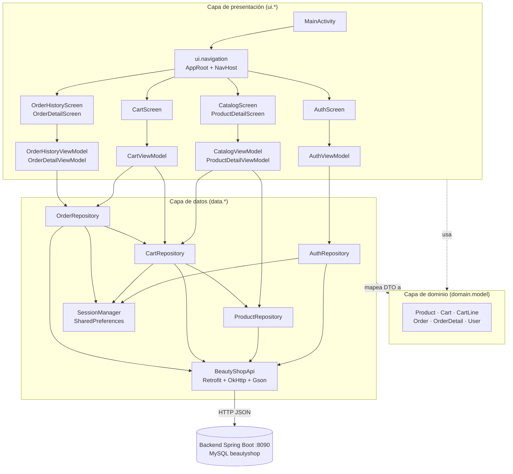

### Estructura de carpetas

```
mobile-android/
├── app/src/main/java/com/beautyshop/movil/
│   ├── MainActivity.kt, BeautyShopApp.kt, AppContainer.kt
│   ├── data/remote/        BeautyShopApi, ApiClient, dto/Dtos.kt
│   ├── data/repository/    Auth/Product/Cart/OrderRepository, SessionManager, Mappers
│   ├── domain/model/       Models.kt
│   ├── ui/auth|catalog|cart|orders/   Pantalla + ViewModel de cada módulo
│   ├── ui/navigation/      Rutas, barra inferior y NavHost
│   ├── ui/theme/, ui/components/
│   └── util/               ApiErrors.kt, Formatters.kt
├── app/src/test/java/com/beautyshop/movil/   Pruebas unitarias (JVM) y API falsa
├── apk/BeautyShopMovil.apk
└── docs/capturas/          Capturas reales del emulador
```

## 2. Patrones de diseño aplicados

| Patrón | Dónde | Para qué |
|--------|-------|----------|
| **MVVM** | `ui.*` (`Screen` + `ViewModel`) | La pantalla solo dibuja un `UiState`; el `ViewModel` contiene la lógica y no conoce a Compose. |
| **Repository** | `data.repository.*` | Ocultan Retrofit y los DTO; devuelven `Result<T>` con modelos del dominio y mensajes de error ya en español. |
| **Observer** (`StateFlow`) | `ViewModel.state`, `CartRepository.cart`, `SessionManager.user` | Las pantallas se actualizan solas cuando cambian los datos (por ejemplo, la insignia del carrito). |
| **Inyección de dependencias manual** | `AppContainer` + `AppViewModelProvider` | Un contenedor crea una sola vez la API y los repositorios; la fábrica de `ViewModel` los entrega por constructor. Sin Hilt. |
| **Mapper / DTO** | `data.repository.Mappers.kt` | Separa el JSON del backend (campos en español, anulables) del modelo de dominio. |
| **Estado único de pantalla** | `*UiState` (`data class`) | Cada pantalla tiene un solo objeto de estado inmutable: cargando, error, vacío o datos. |

## 3. Librerías y frameworks por capa

| Capa | Librería | Versión |
|------|----------|---------|
| Build | Android Gradle Plugin / Kotlin / Gradle | 8.7.3 / 2.0.21 / 8.9 |
| Presentación | Jetpack Compose (BOM) + Material 3 | 2024.12.01 |
| Presentación | Navigation Compose | 2.8.5 |
| Presentación | Lifecycle ViewModel Compose / Runtime Compose | 2.8.7 |
| Presentación | Activity Compose | 1.9.3 |
| Presentación | Material Icons Extended | (BOM) |
| Presentación | Coil Compose (`SubcomposeAsyncImage`) | 2.7.0 |
| Datos | Retrofit + converter-gson (incluye Gson) | 2.11.0 |
| Datos | OkHttp logging-interceptor (OkHttp 4.12) | 4.12.0 |
| Asincronía | Kotlinx Coroutines Android | 1.9.0 |
| Pruebas | JUnit 4 | 4.13.2 |
| Pruebas | kotlinx-coroutines-test | 1.9.0 |

Notas:

- **Fotos de producto:** el backend sirve las imágenes en `GET /images/<archivo>` y el campo `image` trae solo el nombre
  (por ejemplo `labial-rojo.jpg`). `ImageUrls.productImage` arma la URL como `BuildConfig.BASE_URL + "images/" + image`
  (si `image` ya empieza por http o https se usa tal cual). Coil carga la foto en el catálogo y en el detalle; si `image`
  está vacía o la carga falla, se muestra el icono de pincel (`ProductImagePlaceholder`).
- Créditos: fotos de producto de Pexels (licencia libre), ver `docs/CREDITOS_IMAGENES.md` en la raíz del proyecto.
- El tema usa los colores de la tienda web (`frontend/src/index.css`): `--rosa-oscuro #d81072`, `--rosa #ff4da6`,
  `--rosa-suave #ffe3f2`, `--rosa-fondo #ffeef8`, `--texto #3b2f4c`, `--borde #f0d8e7`.

## 4. Configuración de servidor y acceso a datos

La app **no se conecta a MySQL**: habla con el backend REST, y el backend accede a la base de datos `beautyshop`
con JDBC puro (ver README de la raíz).

| Elemento | Valor |
|----------|-------|
| URL base (emulador) | `http://10.0.2.2:8090/` (`10.0.2.2` es el equipo anfitrión visto desde el emulador) |
| Dónde se define | `buildConfigField("String", "BASE_URL", ...)` en `app/build.gradle.kts`; se lee con `BuildConfig.BASE_URL` |
| Cambiarla (celular real) | `./gradlew assembleDebug -PbaseUrl=http://192.168.1.10:8090/` (IP del computador en la red local) |
| Tiempos de espera | 15 s de conexión y 15 s de lectura (`ApiClient`) |
| Texto sin cifrar (HTTP) | Solo para `10.0.2.2` y `localhost`, definido en `res/xml/network_security_config.xml`. Cualquier otro dominio exige HTTPS. |
| Permiso | `android.permission.INTERNET` |
| Sesión | `SessionManager` guarda id, nombre y correo en SharedPreferences privadas. La contraseña nunca se guarda. |
| Registro de red | En debug se registra método, URL y código (nivel `BASIC`). No se registran cuerpos porque llevan la contraseña. |

### Endpoints que consume

| Módulo | Método y ruta |
|--------|---------------|
| Autenticación | `POST /api/auth/register`, `POST /api/auth/login` |
| Catálogo | `GET /api/products` |
| Carrito | `GET /api/cart/{userId}`, `POST /api/cart/{userId}/items`, `PUT` y `DELETE /api/cart/{userId}/items/{productId}` |
| Pedidos | `POST /api/orders/{userId}`, `GET /api/orders/{userId}`, `GET /api/orders/detail/{orderId}` |

Reglas importantes del contrato (no se modificó el backend):

- El carrito del backend solo devuelve ids de producto. La app resuelve los nombres con el catálogo descargado.
- Los errores llegan como `{"error": "mensaje"}`. `ApiErrorMapper` usa ese mensaje en 400 y 404, muestra
  "Correo o contraseña incorrectos." en 401 y un mensaje genérico en errores 5xx, para no exponer detalles internos.
- Cantidades: mínimo 1 y máximo el menor entre el stock del producto y 99.

## 5. Ambientes de desarrollo y pruebas

| Ambiente | Herramientas | Uso |
|----------|--------------|-----|
| Desarrollo | Android Studio (Ladybug o superior) o línea de comandos, JDK 17, Android SDK 35 (`platforms;android-35`, `build-tools;35.0.0`) | Escribir y compilar el código |
| Servidor local | Backend Spring Boot (puerto 8090) + MySQL (8 o superior; se probó con 9.5) con la base `beautyshop` (scripts en `database/*.sql`) | Datos reales para probar |
| Dispositivo | Emulador `Pixel_8_API_35` (arm64, Android 15) o un celular con depuración USB | Ejecutar la app |
| Pruebas unitarias | JUnit 4 + kotlinx-coroutines-test, en la JVM, con API falsa en memoria | Probar sin red, sin emulador y sin MySQL |

Datos usados en esta documentación: macOS (Apple Silicon), JDK 17 (OpenJDK 17.0.17), Gradle 8.9, AGP 8.7.3.

## 6. Cómo compilar, probar e instalar

Desde la carpeta `mobile-android/`. El archivo `local.properties` (con `sdk.dir=...`) es local y no se sube al repositorio;
Android Studio lo crea solo, o créalo así: `echo "sdk.dir=$HOME/Library/Android/sdk" > local.properties`.

```bash
export JAVA_HOME=/opt/homebrew/opt/openjdk@17     # JDK 17

./gradlew testDebugUnitTest      # pruebas unitarias
./gradlew assembleDebug          # genera app/build/outputs/apk/debug/app-debug.apk
```

Para correr la app contra el backend local:

```bash
# 1. MySQL y backend (desde la raíz del proyecto)
brew services start mysql
./mvnw spring-boot:run                       # escucha en el puerto 8090

# 2. Emulador e instalación
~/Library/Android/sdk/emulator/emulator -avd Pixel_8_API_35 &
adb install -r apk/BeautyShopMovil.apk
adb shell am start -n com.beautyshop.movil/.MainActivity
```

El APK incluido en `apk/` es el de depuración (firmado con la llave debug de Android) y apunta a `http://10.0.2.2:8090/`.

## 7. Pruebas unitarias

Se ejecutan con `./gradlew testDebugUnitTest`. Las pruebas usan `FakeBeautyShopApi`, una API en memoria que imita las
reglas reales del backend (correo repetido, 401, cantidad mayor que 0, carrito vacío, etc.), sin Mockito.

**Resultado real: 85 pruebas, 85 correctas, 0 fallidas, 0 omitidas.**

| Módulo | Clase de prueba | Pruebas | Qué verifica |
|--------|-----------------|--------:|--------------|
| Errores | `ApiErrorMapperTest` | 10 | 401, 400 y 404 con y sin cuerpo, 500 sin detalles internos, sin red, tiempo agotado, error desconocido, `safeApiCall` y cancelación |
| Utilidades | `FormattersAndFilterTest` | 9 | Pesos con punto de miles, fechas, estados, búsqueda por nombre y categoría sin tildes, filtro combinado, total del carrito |
| Autenticación (repositorio) | `AuthRepositoryTest` | 10 | Registro y login correctos, validación de nombre, correo y contraseña, correo repetido, contraseña incorrecta, sin conexión, cierre de sesión limpia el carrito |
| Catálogo y carrito (repositorio) | `ProductAndCartRepositoryTest` | 13 | Mapeo y caché del catálogo, carrito sin sesión, total, suma de cantidades, límites de cantidad (0, stock, 99), quitar productos, error de red |
| Pedidos (repositorio) | `OrderRepositoryTest` | 8 | Crear pedido vacía el carrito, carrito vacío, falla de red conserva el carrito, historial ordenado, detalle con nombres, pedido inexistente |
| Autenticación, catálogo y detalle (ViewModel) | `AuthAndCatalogViewModelTest` | 16 | Estados de carga y error del login/registro, búsqueda y filtro por categoría, reintento tras error, agregar al carrito y mensajes, cantidad limitada al stock |
| Carrito y pedidos (ViewModel) | `CartAndOrdersViewModelTest` | 14 | Aumentar y disminuir con límites, quitar, error y reintento, crear pedido (vacía el carrito y publica el número), carrito vacío, falla de red, historial y detalle |
| Fotos de producto (URL) | `ImageUrlsTest` | 5 | Imagen vacía, nombre de archivo, URL absoluta, URL base con y sin "/" final, barra inicial |
| **Total** | | **85** | |

## 8. Prueba manual en emulador (flujo completo)

Flujo ejecutado en el emulador `Pixel_8_API_35` contra el backend real (puerto 8090, MySQL `beautyshop`), instalando el
APK de `apk/`: error de login, registro, catálogo, búsqueda, detalle, agregar al carrito, carrito, crear pedido,
detalle del pedido, historial y carrito vacío. Todos los pasos funcionaron.

| # | Pantalla | Captura |
|---|----------|---------|
| 1 | Inicio de sesión | 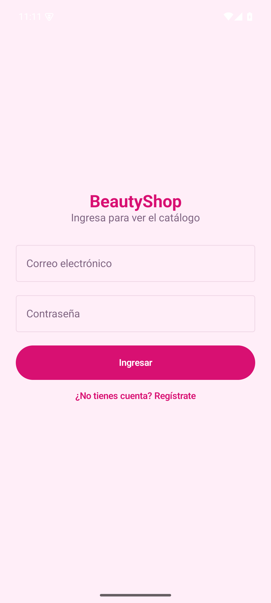 |
| 2 | Error de credenciales (mensaje del servidor traducido) | 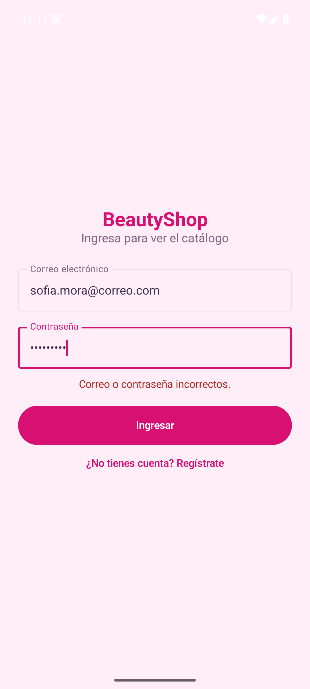 |
| 3 | Registro | 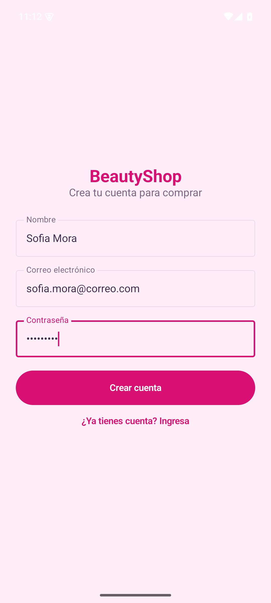 |
| 4 | Catálogo | 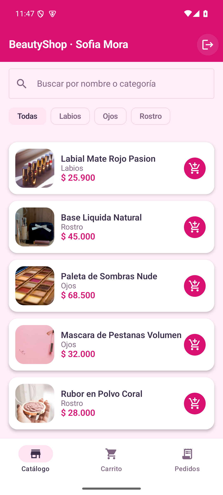 |
| 5 | Búsqueda "ojos" | 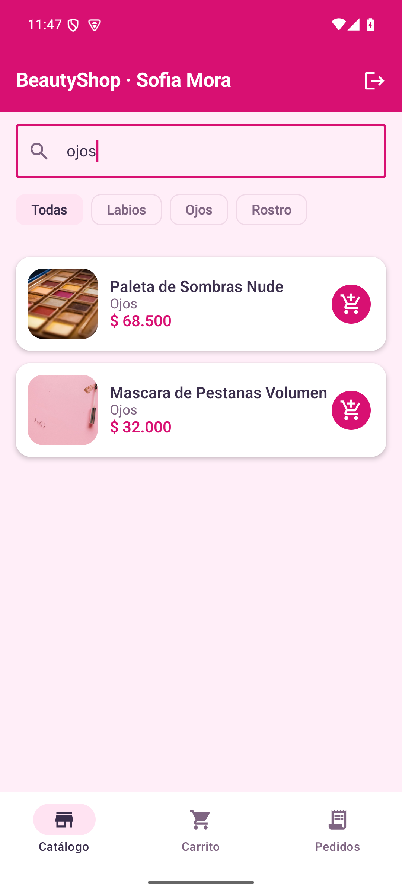 |
| 6 | Detalle de producto | 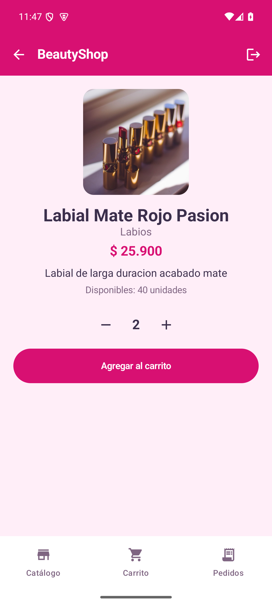 |
| 7 | Producto agregado al carrito | 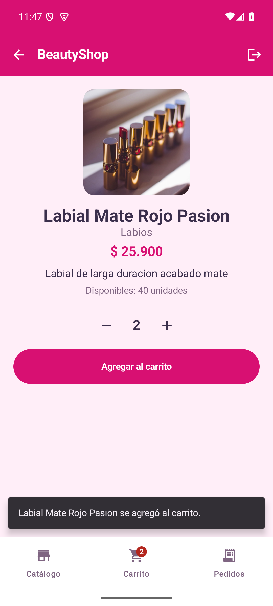 |
| 8 | Catálogo con insignia del carrito | 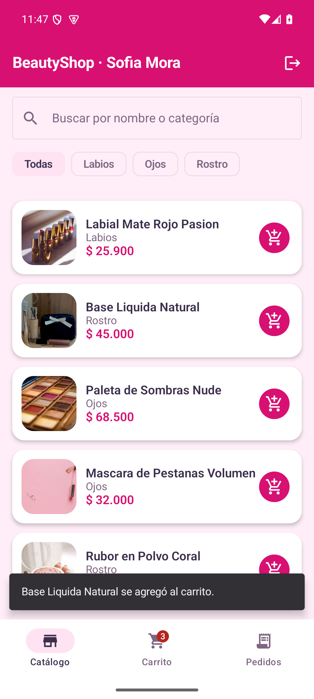 |
| 9 | Carrito con total en COP | 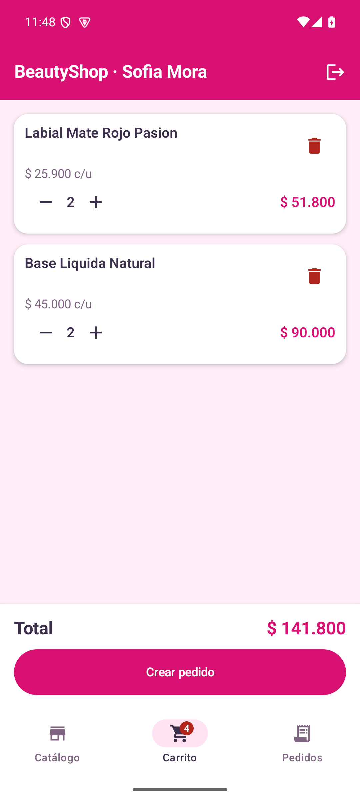 |
| 10 | Detalle del pedido creado |  |
| 11 | Historial de pedidos | 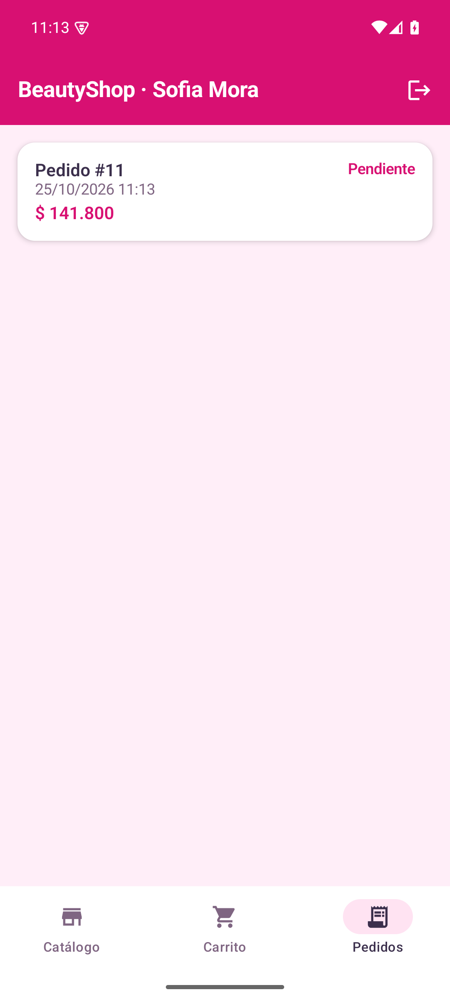 |
| 12 | Carrito vacío tras el pedido | 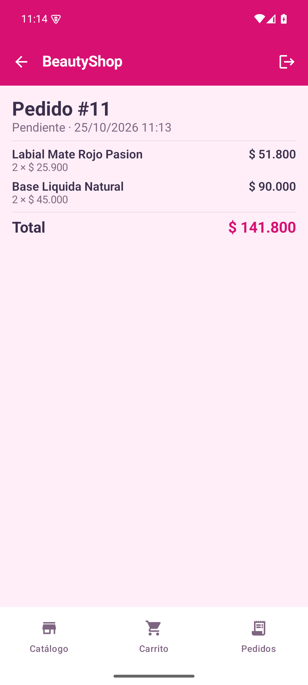 |

## 9. Estándares de codificación

Siguen los del README de la raíz: `camelCase` para variables y funciones, `PascalCase` para clases, sangría de 4 espacios,
líneas de máximo 120 columnas y KDoc en las clases y funciones públicas más importantes. Los textos de la interfaz,
los comentarios y los nombres de las pruebas están en español.
